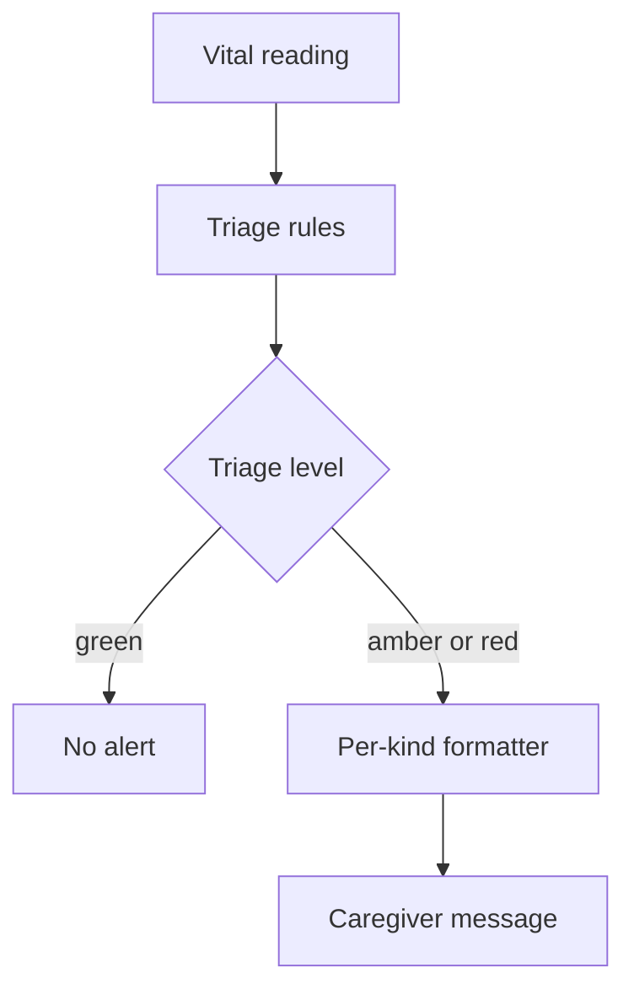

# PR #25: Give each vital its own caregiver message format

- State: CLOSED
- Head at fetch: c8973ade3e452bc15c09650c377962bd0031329c
- https://github.com/sksangita/evergreen-agents/pull/25
- Qodo comments: 2


---
<!-- https://github.com/sksangita/evergreen-agents/pull/25#issuecomment-7033395992 created 2026-11-20T07:33:23Z -->

<h3>PR Summary by Qodo</h3>

Require a caregiver message format for every vital kind


<code>🐞 Bug fix</code> <code>🧪 Tests</code> <code>🕐 Less than 10 minutes</code>


<details>
<summary>AI Description</summary>

<dl>
<dd>
<br/>

><pre>
>• Replace the blood-pressure default with per-vital formatting, preserving existing caregiver
>  message text.
>• Add a coverage test so a new vital kind requires its own format.
></pre>

</dd>
</dl>

</details>

<!-- qodo-describe-risk-slot --><!-- qodo-describe-risk -->
<!-- qodo-describe-risk-start:1795160012.608172894 -->

<details>
<summary>Merge Risk <code>🟢 Low</code></summary>

<dl>
<dd>

<br/>

<details>
<summary>Blast radius <code>🟢 Low</code> <code>💥 1 capability</code></summary>

<dl>
<dd>

<br/>

- 1 affected end-to-end capability after fault-specific containment; implementation boundaries do not widen its functional scope.
- This is one end-to-end Health Sentinel reporting behavior: the assessment constructs the caregiver message and the CLI emits that same AgentResult field.
- The CLI is a consumer of the message, not an independent capability; no separate persistent or external downstream behavior was found.

<details>
<summary>Sources</summary>

<dl>
<dd>

[agents/health_sentinel/agent.py\[44-55\]](https://github.com/sksangita/evergreen-agents/blob/c8973ade3e452bc15c09650c377962bd0031329c/agents/health_sentinel/agent.py#L44-L55)

```python
# One entry per VitalKind (a test enforces it), so no vital reuses another vital's format.
_MEASUREMENT_TEXT: dict[VitalKind, Callable[[VitalReading], str]] = {
    VitalKind.BLOOD_PRESSURE: lambda r: f"BP {r.values['systolic']:g}/{r.values['diastolic']:g}",
    VitalKind.HEART_RATE: lambda r: f"Heart rate {r.values['bpm']:g} bpm",
}


def _caregiver_message(reading: VitalReading, triage: Triage) -> str | None:
    """Built from the reading, not the LLM, so it is always accurate."""
    if triage == Triage.GREEN:
        return None
    measurement = _MEASUREMENT_TEXT[reading.kind](reading)
```

</dd>
</dl>

</details>

</dd>
</dl>

</details>
<details>
<summary>Behavioral complexity <code>🟢 Low</code> <code>🧩 Straightforward</code></summary>

<dl>
<dd>

<br/>

- Before: &#95;caregiver&#95;message used a direct conditional, selecting the heart-rate formatter for HEART&#95;RATE and the blood-pressure formatter otherwise.
- After: it performs a direct dictionary lookup keyed by the validated VitalKind and invokes the selected formatter.
- New correctness condition: every supported VitalKind must have a correctly keyed formatter; the added test checks key-set coverage.
- This is a direct dispatch refactor using unchanged value formatting and UTC conversion, with no new state, ordering, concurrency, persistence, or downstream protocol.

<details>
<summary>Sources</summary>

<dl>
<dd>

[agents/health_sentinel/agent.py\[44-55\]](https://github.com/sksangita/evergreen-agents/blob/c8973ade3e452bc15c09650c377962bd0031329c/agents/health_sentinel/agent.py#L44-L55)

```python
# One entry per VitalKind (a test enforces it), so no vital reuses another vital's format.
_MEASUREMENT_TEXT: dict[VitalKind, Callable[[VitalReading], str]] = {
    VitalKind.BLOOD_PRESSURE: lambda r: f"BP {r.values['systolic']:g}/{r.values['diastolic']:g}",
    VitalKind.HEART_RATE: lambda r: f"Heart rate {r.values['bpm']:g} bpm",
}


def _caregiver_message(reading: VitalReading, triage: Triage) -> str | None:
    """Built from the reading, not the LLM, so it is always accurate."""
    if triage == Triage.GREEN:
        return None
    measurement = _MEASUREMENT_TEXT[reading.kind](reading)
```

[tests/test_heart_rate.py\[92-94\]](https://github.com/sksangita/evergreen-agents/blob/c8973ade3e452bc15c09650c377962bd0031329c/tests/test_heart_rate.py#L92-L94)

```python
def test_every_vital_kind_has_a_caregiver_message_format() -> None:
    # Rule 5: a new vital brings its own caregiver wording, so it cannot crash or reuse another's.
    assert set(_MEASUREMENT_TEXT) == set(VitalKind)
```

</dd>
</dl>

</details>

</dd>
</dl>

</details>
<details>
<summary>Potential damage <code>🟡 Medium</code> <code>🩹 Temporary loss</code></summary>

<dl>
<dd>

<br/>

- A lookup failure prevents the assessment result from being returned to the caregiver-facing output path.
- Triage state is not persisted or externally applied by this code, and the source shows no automatic retry or repair path.
- Reverting the code or adding the missing formatter restores behavior; any caller that already received no result would need to resubmit the reading.
- The equal-importance baseline is used because no business-criticality declaration was supplied.
- Recoverable by code rollback or formatter correction followed by retrying the affected assessment.
- No persistent state repair or external compensation is indicated by the inspected path.

<details>
<summary>Sources</summary>

<dl>
<dd>

[agents/health_sentinel/agent.py\[44-55\]](https://github.com/sksangita/evergreen-agents/blob/c8973ade3e452bc15c09650c377962bd0031329c/agents/health_sentinel/agent.py#L44-L55)

```python
# One entry per VitalKind (a test enforces it), so no vital reuses another vital's format.
_MEASUREMENT_TEXT: dict[VitalKind, Callable[[VitalReading], str]] = {
    VitalKind.BLOOD_PRESSURE: lambda r: f"BP {r.values['systolic']:g}/{r.values['diastolic']:g}",
    VitalKind.HEART_RATE: lambda r: f"Heart rate {r.values['bpm']:g} bpm",
}


def _caregiver_message(reading: VitalReading, triage: Triage) -> str | None:
    """Built from the reading, not the LLM, so it is always accurate."""
    if triage == Triage.GREEN:
        return None
    measurement = _MEASUREMENT_TEXT[reading.kind](reading)
```

[agents/health_sentinel/__main__.py\[50-56\]](https://github.com/sksangita/evergreen-agents/blob/c8973ade3e452bc15c09650c377962bd0031329c/agents/health_sentinel/__main__.py#L50-L56)

```python
    result = HealthSentinel(load_rules(), get_client()).assess(reading, trace_id)

    print(f"Triage:     {result.triage.value.upper()}")
    print(f"Escalate:   {'yes' if result.requires_escalation else 'no'}")
    print(f"Reasons:    {'; '.join(result.reasons)}")
    print(f"To elder:   {result.message_for_elder}")
    print(f"To carer:   {result.message_for_caregiver or '-'}")
```

</dd>
</dl>

</details>

</dd>
</dl>

</details>
<sub>Assessed commit <a href="https://github.com/sksangita/evergreen-agents/commit/c8973ade3e452bc15c09650c377962bd0031329c">c8973ad</a></sub>


<!-- https://github.com/sksangita/evergreen-agents/commit/c8973ade3e452bc15c09650c377962bd0031329c -->
</dd>
</dl>
</details>
<!-- /qodo-describe-risk -->

<details>
<summary>Diagram</summary>

<dl>
<dd>

<br/>



</dd>
</dl>

</details>


<details>
<summary>High-Level Assessment</summary>

<dl>
<dd>

<br/>

>Keep the per-kind formatter map and coverage test. An explicit conditional branch would still need an exhaustiveness check and would make the supported formats less apparent.

</dd>
</dl>

</details>

<details>
<summary> Files changed (2) <code> +15 / -4 </code> </summary>

<dl>
<dd>

<br/>

<details>
<summary>Bug fix (1) <code> +9 / -4 </code></summary>

<dl>
<dd>

<details>
<summary>agent.py<code>Select caregiver measurement text by vital kind</code> <code>+9/-4</code></summary>

<br/>

>Select caregiver measurement text by vital kind
>
><pre>
>• Adds a formatter for each current VitalKind and uses it for non-green caregiver messages instead of treating every non-heart-rate reading as blood pressure. Existing blood-pressure and heart-rate wording remains unchanged.
></pre>
>
><a href='https://github.com/sksangita/evergreen-agents/pull/25/files#diff-cb3f24e657bc617c84440ac5d4d5542fd38b69f7aec8db4780b74a36ea70104b'>agents/health_sentinel/agent.py</a>

</details>

</dd>
</dl>

</details>

<details>
<summary>Tests (1) <code> +6 / -0 </code></summary>

<dl>
<dd>

<details>
<summary>test_heart_rate.py<code>Require formatter coverage for all vital kinds</code> <code>+6/-0</code></summary>

<br/>

>Require formatter coverage for all vital kinds
>
><pre>
>• Adds an assertion that the formatter map&#x27;s keys exactly match VitalKind, so introducing a kind without an entry fails the test.
></pre>
>
><a href='https://github.com/sksangita/evergreen-agents/pull/25/files#diff-91e715c9b7a0bf4241bc17e94976ab1d9c94ce9c4b8aab316bc50d5001933c08'>tests/test_heart_rate.py</a>

</details>

</dd>
</dl>

</details>

</dd>
</dl>

</details>

<!-- qodo-describe-head:c8973ade3e452bc15c09650c377962bd0031329c -->

---
<!-- https://github.com/sksangita/evergreen-agents/pull/25#issuecomment-7033397711 created 2026-11-20T07:33:28Z -->


<h3>Code Review by Qodo</h3>
<code>🐞 Bugs (0)</code>  <code>📘 Rule violations (0)</code>  <code>📎 Requirement gaps (0)</code>

<br/>


<h3>Great, no issues found!</h3>
Qodo reviewed your code and found no material issues that require review

<br/>


<!-- https://github.com/sksangita/evergreen-agents/commit/c8973ade3e452bc15c09650c377962bd0031329c -->

<a href="https://www.qodo.ai"></a>
