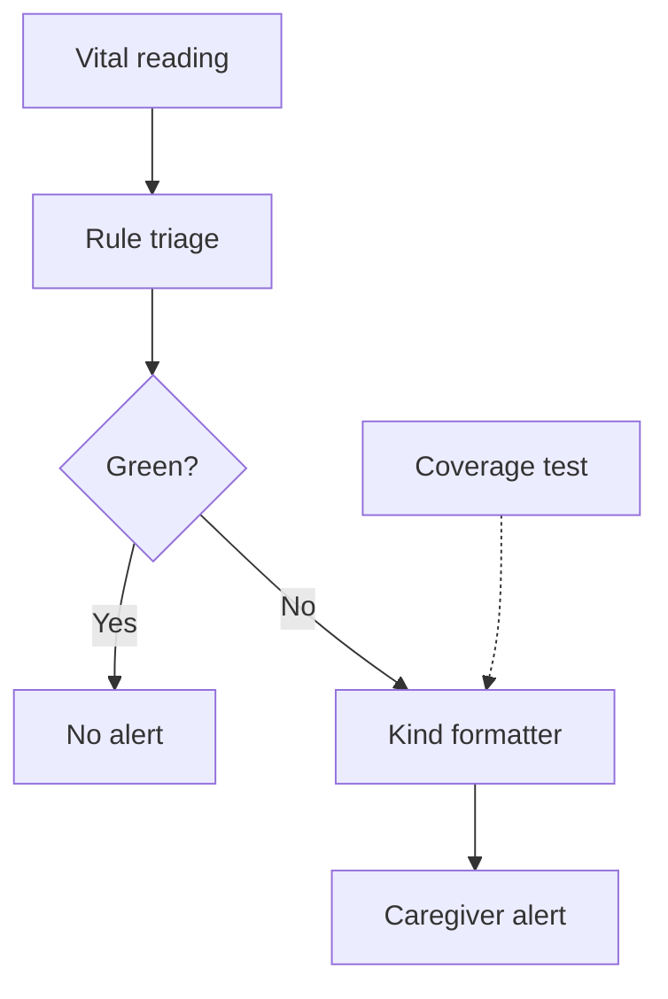

# PR #29: Give each vital its own caregiver message format

- State: MERGED
- Head at fetch: c8973ade3e452bc15c09650c377962bd0031329c
- https://github.com/sksangita/evergreen-agents/pull/29
- Qodo comments: 2

---
<!-- https://github.com/sksangita/evergreen-agents/pull/29#issuecomment-7034576978 created 2026-11-20T08:37:33Z -->

<h3>PR Summary by Qodo</h3>

Require a caregiver message format for every vital kind

<code>🐞 Bug fix</code> <code>🧪 Tests</code> <code>🕐 Less than 10 minutes</code>

AI Description

<dl>
<dd>
 

><pre>
>• Replaces the blood-pressure default with a format selected for each vital kind.
>• Adds a coverage test so new vital kinds require caregiver wording.
>• Preserves existing caregiver messages for blood pressure and heart rate.
></pre>

</dd>
</dl>

<!-- qodo-describe-risk-slot --><!-- qodo-describe-risk -->
<!-- qodo-describe-risk-start:1795163875.293447971 -->

Merge Risk <code>🟢 Low</code>

<dl>
<dd>

 

Blast radius <code>🟢 Low</code> <code>💥 1 capability</code>

<dl>
<dd>

 

- 1 affected end-to-end capability after fault-specific containment; implementation boundaries do not widen its functional scope.
- The changed formatter is called during the single HealthSentinel assessment flow and its message is consumed by the same flow&#x27;s caregiver-output surface.
- The formatter, AgentResult field, and CLI print are implementation hops of one bounded health-sentinel behavior, not independent capabilities.

</dd>
</dl>

Behavioral complexity <code>🟢 Low</code> <code>🧩 Straightforward</code>

<dl>
<dd>

 

- Before: &#95;caregiver&#95;message selected one of two fixed strings with an if/else branch.
- After: it performs a direct lookup of a formatter keyed by the already validated VitalKind.
- New correctness condition: every supported VitalKind must have the correct formatter and matching value keys; this is a simple dispatch completeness condition, not a new interacting state, algorithm, concurrency protocol, compatibility transition, or coordinated invariant.

</dd>
</dl>

Potential damage <code>🟡 Medium</code> <code>🩹 Temporary loss</code>

<dl>
<dd>

 

- A dispatch failure can make the health-sentinel assessment unavailable to its caller for that reading, including the caregiver notification.
- Recovery is code correction and retry; the change writes no persistent state and creates no external side effect requiring compensation.
- For a wrong-but-returned formatter, the residual effect would be limited to an incorrect caregiver message, but the more consequential supported fault classification is temporary loss of this assessment delivery path.
- Recoverable by restoring the mapping/formatter invariant and retrying the reading.
- No persistent state repair or external compensation is required; the current source does not provide an automatic retry or fallback around &#95;MEASUREMENT&#95;TEXT lookup.

</dd>
</dl>

Assessed commit <a href="https://github.com/sksangita/evergreen-agents/commit/c8973ade3e452bc15c09650c377962bd0031329c">c8973ad</a>

<!-- https://github.com/sksangita/evergreen-agents/commit/c8973ade3e452bc15c09650c377962bd0031329c -->
</dd>
</dl>

<!-- /qodo-describe-risk -->

Diagram

<dl>
<dd>

 

</dd>
</dl>

High-Level Assessment

<dl>
<dd>

 

>The per-kind formatter map and exhaustive coverage test address the unsafe default without changing existing alert text. Extending the conditional would retain the risk of treating an unrecognized kind as another vital.

</dd>
</dl>

 Files changed (2) <code> +15 / -4 </code> 

<dl>
<dd>

 

Bug fix (1) <code> +9 / -4 </code>

<dl>
<dd>

agent.py<code>Select caregiver measurement text by vital kind</code> <code>+9/-4</code>

 

>Select caregiver measurement text by vital kind
>
><pre>
>• Adds a formatter for each existing VitalKind and uses the map for non-green caregiver messages instead of treating every non-heart-rate reading as blood pressure. Existing message wording remains unchanged.
></pre>
>
><a href='https://github.com/sksangita/evergreen-agents/pull/29/files#diff-cb3f24e657bc617c84440ac5d4d5542fd38b69f7aec8db4780b74a36ea70104b'>agents/health_sentinel/agent.py</a>

</dd>
</dl>

Tests (1) <code> +6 / -0 </code>

<dl>
<dd>

test_heart_rate.py<code>Require formatter coverage for every vital kind</code> <code>+6/-0</code>

 

>Require formatter coverage for every vital kind
>
><pre>
>• Adds an assertion that the caregiver formatter map has exactly the same keys as VitalKind, so adding a kind without a message format fails the test.
></pre>
>
><a href='https://github.com/sksangita/evergreen-agents/pull/29/files#diff-91e715c9b7a0bf4241bc17e94976ab1d9c94ce9c4b8aab316bc50d5001933c08'>tests/test_heart_rate.py</a>

</dd>
</dl>

</dd>
</dl>

<!-- qodo-describe-head:c8973ade3e452bc15c09650c377962bd0031329c -->

---
<!-- https://github.com/sksangita/evergreen-agents/pull/29#issuecomment-7034582689 created 2026-11-20T08:37:51Z -->

<h3>Code Review by Qodo</h3>
<code>🐞 Bugs (0)</code>  <code>📘 Rule violations (0)</code>  <code>📎 Requirement gaps (0)</code>

 

<h3>Great, no issues found!</h3>
Qodo reviewed your code and found no material issues that require review

 

<!-- https://github.com/sksangita/evergreen-agents/commit/c8973ade3e452bc15c09650c377962bd0031329c -->

