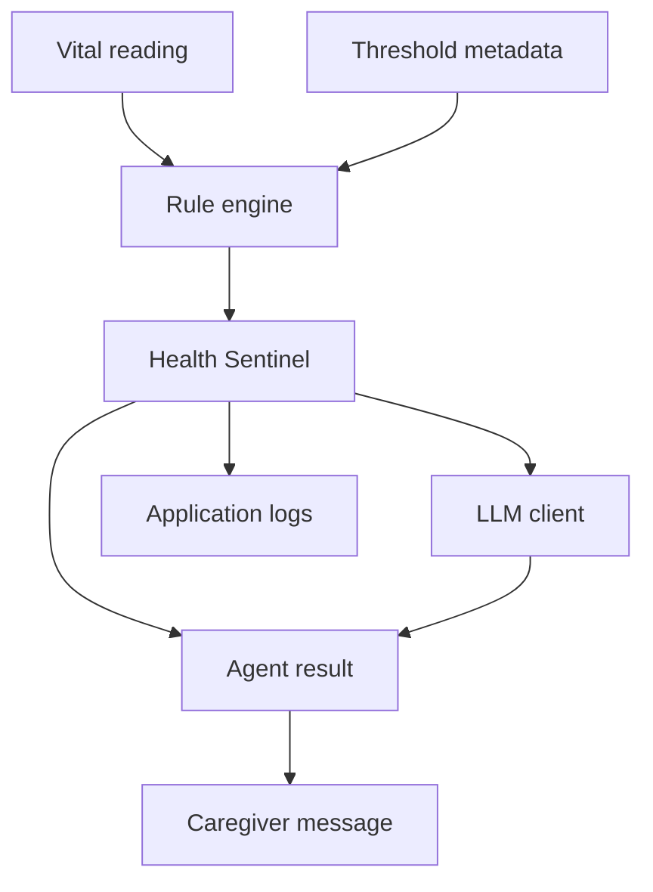

# PR #30: Experiment: planted deviations (do not merge)

- State: CLOSED
- Head at fetch: 2570aa563b31c8d0e3af2633b727296016aff50b
- https://github.com/sksangita/evergreen-agents/pull/30
- Qodo comments: 2


---
<!-- https://github.com/sksangita/evergreen-agents/pull/30#issuecomment-7034805122 created 2026-11-20T08:49:19Z -->

<h3>PR Summary by Qodo</h3>

Experiment: plant heart-rate safety deviations (do not merge)


<code>✨ Enhancement</code> <code>🧪 Tests</code> <code>⚙️ Configuration changes</code> <code>🕐 10-20 Minutes</code>


<details>
<summary>AI Description</summary>

<dl>
<dd>
<br/>

><pre>
>• Introduces deliberate heart-rate escalation, logging, and timestamp deviations to test review
>  detection.
>• Weakens caregiver-message coverage and adds a network-dependent test, contrary to project rules.
>• Changes a threshold source citation; this throwaway PR must not be merged.
></pre>

</dd>
</dl>

</details>

<!-- qodo-describe-risk-slot --><!-- qodo-describe-risk -->
<!-- qodo-describe-risk-start:1795164638.230145931 -->

<details>
<summary>Merge Risk <code>🟡 Medium</code></summary>

<dl>
<dd>

<br/>

<details>
<summary>Blast radius <code>🟡 Medium</code> <code>💥 2 capabilities</code></summary>

<dl>
<dd>

<br/>

- 2 affected capabilities within one bounded functional scope: health&#95;sentinel&#95;vital&#95;triage.
- This is an operational behavior of the same bounded health-sentinel vital-triage integration as caregiver output: the assessment creates the log record while the CLI is only a presentation caller.
- It is not a separate deployment or storage capability.
- The caregiver message is one end-to-end outcome of the bounded health-sentinel vital-triage integration.
- The CLI prints this result, but it does not create an independent functional scope or notification system.


</dd>
</dl>

</details>
<details>
<summary>Behavioral complexity <code>🟢 Low</code> <code>🧩 Straightforward</code></summary>

<dl>
<dd>

<br/>

- Before, the assessment did not emit this record.
- After, it performs one direct logging operation using existing reading fields.
- No new algorithm, state machine, synchronization protocol, or transformation is introduced; the correctness condition is simply that sensitive fields must not be emitted to an unauthorized sink.


</dd>
</dl>

</details>
<details>
<summary>Potential damage <code>🔴 High</code> <code>🩹 Confidentiality</code></summary>

<dl>
<dd>

<br/>

- Raw vital values are health information and elder&#95;id is identifying information.
- Unauthorized access to the configured log sink could expose both.
- This is a plausible activated consequence, although the repository does not prove that the sink is externally accessible.
- Reverting the code prevents future emissions, but already written records require log deletion, retention expiry, or access-control remediation.
- Code rollback alone does not retract existing log entries.


</dd>
</dl>

</details>
<sub>Assessed commit <a href="https://github.com/sksangita/evergreen-agents/commit/2570aa563b31c8d0e3af2633b727296016aff50b">2570aa5</a></sub>


<!-- https://github.com/sksangita/evergreen-agents/commit/2570aa563b31c8d0e3af2633b727296016aff50b -->
</dd>
</dl>
</details>
<!-- /qodo-describe-risk -->

<details>
<summary>Diagram</summary>

<dl>
<dd>

<br/>



</dd>
</dl>

</details>


<details>
<summary>High-Level Assessment</summary>

<dl>
<dd>

<br/>

>The following are alternative approaches to this PR:

<details>
<summary><b>1. Isolated review fixture</b></summary>

<dl>
<dd>

- ➕ Exercises review detection without changing mergeable application code or the offline test suite.
- ➖ May not reproduce the exact experience of reviewing a live application PR.

</dd>
</dl>

</details>

>**Recommendation:** Keep this PR strictly as a disposable positive control and do not merge it. For repeat experiments, prefer an isolated review fixture so planted safety and privacy violations cannot enter the application.

</dd>
</dl>

</details>

<details>
<summary> Files changed (4) <code> +19 / -8 </code> </summary>

<dl>
<dd>

<br/>

<details>
<summary>Enhancement (1) <code> +11 / -2 </code></summary>

<dl>
<dd>

<details>
<summary>agent.py<code>Plant escalation, logging, and timestamp deviations</code> <code>+11/-2</code></summary>

<br/>

>Plant escalation, logging, and timestamp deviations
>
><pre>
>• Logs the elder ID and reading values. Adds an agent-level escalation condition for bpm above 150 and removes the date and timezone from heart-rate caregiver messages.
></pre>
>
><a href='https://github.com/sksangita/evergreen-agents/pull/30/files#diff-cb3f24e657bc617c84440ac5d4d5542fd38b69f7aec8db4780b74a36ea70104b'>agents/health_sentinel/agent.py</a>

</details>

</dd>
</dl>

</details>

<details>
<summary>Tests (2) <code> +7 / -5 </code></summary>

<dl>
<dd>

<details>
<summary>test_heart_rate.py<code>Weaken caregiver-message verification</code> <code>+1/-5</code></summary>

<br/>

>Weaken caregiver-message verification
>
><pre>
>• Replaces an assertion checking the complete caregiver message, including its UTC date and time, with one checking only whether a message exists. The escalation assertion remains unchanged.
></pre>
>
><a href='https://github.com/sksangita/evergreen-agents/pull/30/files#diff-91e715c9b7a0bf4241bc17e94976ab1d9c94ce9c4b8aab316bc50d5001933c08'>tests/test_heart_rate.py</a>

</details>

<details>
<summary>test_network_probe.py<code>Add an external-network test</code> <code>+6/-0</code></summary>

<br/>

>Add an external-network test
>
><pre>
>• Adds a test that opens a TCP connection to example.com on port 443. It makes the normally offline test suite dependent on network availability.
></pre>
>
><a href='https://github.com/sksangita/evergreen-agents/pull/30/files#diff-3677480e22cbe66549b0d2bac276b77d109b23d574b79cb8075b3dfcac73e3a3'>tests/test_network_probe.py</a>

</details>

</dd>
</dl>

</details>

<details>
<summary>Other (1) <code> +1 / -1 </code></summary>

<dl>
<dd>

<details>
<summary>thresholds.yaml<code>Change the heart-rate rule source citation</code> <code>+1/-1</code></summary>

<br/>

>Change the heart-rate rule source citation
>
><pre>
>• Rewords the amber heart-rate rule&#x27;s source from an explicitly unverified general reference to a resting-heart-rate reference. The threshold itself does not change; this rules-file edit requires human review.
></pre>
>
><a href='https://github.com/sksangita/evergreen-agents/pull/30/files#diff-fe075708c66321086515e636cb9e48bc83368595fbb9808e08005b74277d77da'>core/rules/thresholds.yaml</a>

</details>

</dd>
</dl>

</details>

</dd>
</dl>

</details>

<!-- qodo-describe-head:2570aa563b31c8d0e3af2633b727296016aff50b -->

---
<!-- https://github.com/sksangita/evergreen-agents/pull/30#issuecomment-7034828139 created 2026-11-20T08:50:33Z -->

<h3>Code Review by Qodo</h3>

<br/>


<details>
<summary>  1.  Heart-rate alert shows clock time only <code>📘 Rule violation</code></summary>

<br/>

> <details>
><summary>Description</summary>
><br/>
>
><pre>
><b><i>_caregiver_message</i></b> formats heart-rate timestamps with <b><i>%H:%M</i></b> instead of <b><i>_utc_text</i></b>, omitting the
>date and timezone and bypassing UTC conversion. When a heart-rate reading has a valid non-UTC
>timestamp, the message contains only its local clock time, and the CLI presents that message
>directly to the caregiver.
></pre>
></details>

> <details>
><summary>Agent prompt</summary>
><br/>
>
>```
>The issue below was found during a code review. Follow the provided context and guidance below and implement a solution
>
>## Issue description
>Heart-rate caregiver messages omit the measurement date and timezone and bypass UTC conversion.
>
>## Fix Focus Areas
>- agents/health_sentinel/agent.py[55-60]
>- tests/test_heart_rate.py[70-73]
>
>## Recommended Fix
>Remove the kind-specific timestamp branch and use `_utc_text(reading.measured_at)` for both heart-rate and blood-pressure messages. Test the complete heart-rate message with UTC and non-UTC timezone-aware readings.
>```
> <code>ⓘ Copy this prompt and use it to remediate the issue with your preferred AI generation tools</code>
></details>

[Dismiss ↗](https://app.qodo.ai/findings/308fefa0-052a-4e41-8315-7850ddead416?action=dismiss&origin=git) | [View ↗](https://app.qodo.ai/findings/308fefa0-052a-4e41-8315-7850ddead416)

</details>


<details>
<summary>  2.  Escalation set outside the rules engine <code>📘 Rule violation</code></summary>

<br/>

> <details>
><summary>Description</summary>
><br/>
>
><pre>
><b><i>HealthSentinel.assess</i></b> ORs <b><i>decision.requires_escalation</i></b> with a hard-coded
><b><i>reading.values.get(&quot;bpm&quot;, 0) &gt; 150</i></b> check, allowing the agent to override its supplied ruleset.
>With a ruleset whose red cutoff is above 155 bpm, a 155 bpm reading can be classified amber but
>still marked for escalation under that ruleset&#x27;s version label; a missing <b><i>bpm</i></b> key defaults to 0
>and silently bypasses the check.
></pre>
></details>

> <details>
><summary>Agent prompt</summary>
><br/>
>
>```
>The issue below was found during a code review. Follow the provided context and guidance below and implement a solution
>
>## Issue description
>The agent's hard-coded bpm threshold can mark a reading for escalation even when its supplied ruleset does not.
>
>## Fix Focus Areas
>- agents/health_sentinel/agent.py[39-43]
>- core/rules/engine.py[129-159]
>
>## Recommended Fix
>Remove the hard-coded bpm check and set `requires_escalation=decision.requires_escalation`. If 150 bpm needs its own escalation policy, define and version it in core/rules with a sourced threshold and boundary tests.
>```
> <code>ⓘ Copy this prompt and use it to remediate the issue with your preferred AI generation tools</code>
></details>

[Dismiss ↗](https://app.qodo.ai/findings/755567be-7db1-4dc0-bd33-e6d443a2ffb7?action=dismiss&origin=git) | [View ↗](https://app.qodo.ai/findings/755567be-7db1-4dc0-bd33-e6d443a2ffb7)

</details>


<details>
<summary>  3.  Health readings are written to logs <code>📘 Rule violation</code></summary>

<br/>

> <details>
><summary>Description</summary>
><br/>
>
><pre>
><b><i>HealthSentinel.assess</i></b> passes <b><i>reading.elder_id</i></b> and the complete <b><i>reading.values</i></b> dictionary to
><b><i>logger.info</i></b>, exposing heart-rate or blood-pressure measurements alongside the elder ID. This runs
>on every assessment, including those that return green, and sends those details to the application
>log stream for anyone with log access to read.
></pre>
></details>

> <details>
><summary>Agent prompt</summary>
><br/>
>
>```
>The issue below was found during a code review. Follow the provided context and guidance below and implement a solution
>
>## Issue description
>`HealthSentinel.assess` logs the elder identifier and raw health measurements in `agents/health_sentinel/agent.py`, including for green assessments.
>
>## Fix Focus Areas
>- agents/health_sentinel/agent.py[22-25]
>
>## Recommended Fix
>Remove the log call that passes `reading.elder_id` and `reading.values`, or replace it with one that logs only non-sensitive operational metadata, such as `trace_id` and `decision.triage`. Retain the existing privacy test.
>```
> <code>ⓘ Copy this prompt and use it to remediate the issue with your preferred AI generation tools</code>
></details>

[Dismiss ↗](https://app.qodo.ai/findings/a7d9abc3-96ff-49a6-a019-548d01c20044?action=dismiss&origin=git) | [View ↗](https://app.qodo.ai/findings/a7d9abc3-96ff-49a6-a019-548d01c20044)

</details>


<br/>

<details><summary><ins><strong>View medium (2)</strong></ins></summary><br/>


<details>
<summary>  4.  Message test no longer checks the time <code>📘 Rule violation</code></summary>

<br/>

> <details>
><summary>Description</summary>
><br/>
>
><pre>
><b><i>test_heart_rate_full_result</i></b> replaces its exact caregiver-message assertion with a check that only
>distinguishes <b><i>None</i></b> from non-<b><i>None</i></b>. For amber and red readings, the test now accepts any string,
>so it misses changes to the measurement, date, UTC timestamp, and triage text, including the
>clock-only regression.
></pre>
></details>

> <details>
><summary>Agent prompt</summary>
><br/>
>
>```
>The issue below was found during a code review. Follow the provided context and guidance below and implement a solution
>
>## Issue description
>The heart-rate test no longer checks caregiver-message content or timestamp formatting for non-green readings.
>
>## Fix Focus Areas
>- tests/test_heart_rate.py[70-76]
>
>## Recommended Fix
>Restore an exact expected-message assertion for non-green readings that checks the measurement, date, UTC timestamp, and triage text against the corrected time format. Retain the green `None` check and add coverage for an aware non-UTC reading.
>```
> <code>ⓘ Copy this prompt and use it to remediate the issue with your preferred AI generation tools</code>
></details>

[Dismiss ↗](https://app.qodo.ai/findings/4b9e810c-aae9-4c65-8232-a556f29e3aa4?action=dismiss&origin=git) | [View ↗](https://app.qodo.ai/findings/4b9e810c-aae9-4c65-8232-a556f29e3aa4)

</details>


<details>
<summary>  5.  Test suite now needs internet access <code>📘 Rule violation</code></summary>

<br/>

> <details>
><summary>Description</summary>
><br/>
>
><pre>
><b><i>test_can_reach_example_host</i></b> uses <b><i>socket.create_connection</i></b> to open a real TCP connection to
><b><i>example.com:443</i></b> instead of testing an isolated component. Because the ordinary <b><i>make test</i></b> run
>collects it, local and CI runs without outbound connectivity can fail or wait for a connection
>timeout.
></pre>
></details>

> <details>
><summary>Agent prompt</summary>
><br/>
>
>```
>The issue below was found during a code review. Follow the provided context and guidance below and implement a solution
>
>## Issue description
>The default test suite opens a live connection to `example.com:443` and cannot reliably run offline.
>
>## Fix Focus Areas
>- tests/test_network_probe.py[1-6]
>
>## Recommended Fix
>Remove the probe from the default suite, or replace the socket call with an isolated local or mocked transport that does not depend on DNS or internet access.
>```
> <code>ⓘ Copy this prompt and use it to remediate the issue with your preferred AI generation tools</code>
></details>

[Dismiss ↗](https://app.qodo.ai/findings/deea48d1-a01a-4551-b344-71729a329d79?action=dismiss&origin=git) | [View ↗](https://app.qodo.ai/findings/deea48d1-a01a-4551-b344-71729a329d79)

</details>


</details>

<br/>

<!-- qodo-self-review-slot -->


<!-- qodo-context:start -->
<details><summary><strong>Context sources</strong></summary>

<div>&#x2705; Compliance rules (platform): <a href="https://app.qodo.ai/rules?state=active&amp;scopes=/sksangita/evergreen-agents/"><code>24 rules</code></a></div>
<div>&#x2705; REVIEW.md</div>
<div>Review mode: <code>⚖️ Balanced</code>: Comment request</div>
<!-- qodo-context:end -->
</details>

<br/>
<!-- https://github.com/sksangita/evergreen-agents/commit/2570aa563b31c8d0e3af2633b727296016aff50b -->

