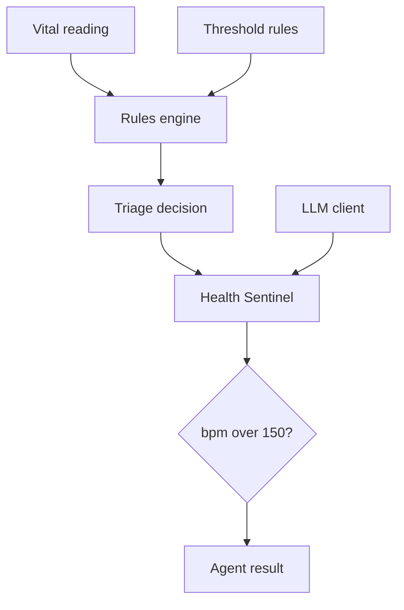

# PR #33: Experiment: planted deviations, control v2 (do not merge)

- State: CLOSED
- Head at fetch: f5477d819f534ee6ad657f860af78143880e1b35
- https://github.com/sksangita/evergreen-agents/pull/33
- Qodo comments: 2


---
<!-- https://github.com/sksangita/evergreen-agents/pull/33#issuecomment-7036607455 created 2026-11-20T09:58:24Z -->

<h3>PR Summary by Qodo</h3>

Experiment: Plant heart-rate safety deviations (do not merge)


<code>✨ Enhancement</code> <code>🧪 Tests</code> <code>⚙️ Configuration changes</code> <code>🕐 10-20 Minutes</code>


<details>
<summary>AI Description</summary>

<dl>
<dd>
<br/>

><pre>
>• Add a heart-rate escalation override, sensitive logging, and caregiver times without dates or
>  zones.
>• Weaken heart-rate message assertions, revise a rule citation, and add a network-dependent test.
>• Preserve this as a throwaway review experiment; the changes violate project safety and
>  offline-test rules.
></pre>

</dd>
</dl>

</details>

<!-- qodo-describe-risk-slot --><!-- qodo-describe-risk -->
<!-- qodo-describe-risk-start:1795189755.732031107 -->

<details>
<summary>Merge Risk <code>🟡 Medium</code></summary>

<dl>
<dd>

<br/>

<details>
<summary>Blast radius <code>🟡 Medium</code> <code>💥 2 capabilities</code></summary>

<dl>
<dd>

<br/>

- 2 affected capabilities within one bounded functional scope: health&#95;sentinel&#95;triage.
- The changed logging occurs inside the same end-to-end assessment that computes triage and constructs the result.
- The CLI invokes this assessment directly, so this is one bounded health-sentinel triage behavior rather than an independent logging subsystem.
- This is a distinct output behavior of the same bounded health-sentinel triage integration: it generates the caregiver-facing representation of the assessment.
- It shares the functional scope with health&#95;assessment because both are produced by the same assessment flow and no independent notification integration is shown.

<details>
<summary>Sources</summary>

<dl>
<dd>

[agents/health_sentinel/__main__.py\[50-56\]](https://github.com/sksangita/evergreen-agents/blob/f5477d819f534ee6ad657f860af78143880e1b35/agents/health_sentinel/__main__.py#L50-L56)

```python
    result = HealthSentinel(load_rules(), get_client()).assess(reading, trace_id)

    print(f"Triage:     {result.triage.value.upper()}")
    print(f"Escalate:   {'yes' if result.requires_escalation else 'no'}")
    print(f"Reasons:    {'; '.join(result.reasons)}")
    print(f"To elder:   {result.message_for_elder}")
    print(f"To carer:   {result.message_for_caregiver or '-'}")
```

</dd>
</dl>

</details>

</dd>
</dl>

</details>
<details>
<summary>Behavioral complexity <code>🟢 Low</code> <code>🧩 Straightforward</code></summary>

<dl>
<dd>

<br/>

- Before, assessment computed the decision without this logging side effect.
- After, it performs a direct INFO logging operation using existing reading fields.
- The new correctness condition is that operational logging must not disclose sensitive reading data; there are no newly interacting states, algorithms, or coordination protocols.


</dd>
</dl>

</details>
<details>
<summary>Potential damage <code>🔴 High</code> <code>🩹 Confidentiality</code></summary>

<dl>
<dd>

<br/>

- A fault in this new side effect can disclose identifiable elder context together with vital measurements through operational logs.
- Reverting the code prevents future records but does not remove records already emitted; source does not show log redaction, access controls, retention, or deletion.
- The repository describes synthetic data, but the runtime behavior still carries health-related values and an elder identifier.
- Future exposure is stopped by code rollback or disabling the relevant log level, but already emitted records require log-sink access and retention/deletion controls that are not shown.
- Manual log review and removal may be needed.


</dd>
</dl>

</details>
<sub>Assessed commit <a href="https://github.com/sksangita/evergreen-agents/commit/f5477d819f534ee6ad657f860af78143880e1b35">f5477d8</a></sub>


<!-- https://github.com/sksangita/evergreen-agents/commit/f5477d819f534ee6ad657f860af78143880e1b35 -->
</dd>
</dl>
</details>
<!-- /qodo-describe-risk -->

<details>
<summary>Diagram</summary>

<dl>
<dd>

<br/>



</dd>
</dl>

</details>


<details>
<summary>High-Level Assessment</summary>

<dl>
<dd>

<br/>

>The following are alternative approaches to this PR:

<details>
<summary><b>1. Keep safety decisions in rules and tests offline</b></summary>

<dl>
<dd>

- ➕ Preserves a single deterministic authority for escalation.
- ➕ Keeps caregiver times unambiguous and tests reliable without network access.
- ➖ Would not serve this experiment&#x27;s purpose of planting review deviations.

</dd>
</dl>

</details>

>**Recommendation:** Do not merge this experimental approach. For production work, put any new escalation criterion in core/rules with edge-case tests, retain date-and-zone timestamps and log-safe identifiers, and replace the socket probe with an offline test.

</dd>
</dl>

</details>

<details>
<summary> Files changed (4) <code> +19 / -8 </code> </summary>

<dl>
<dd>

<br/>

<details>
<summary>Enhancement (1) <code> +11 / -2 </code></summary>

<dl>
<dd>

<details>
<summary>agent.py<code>Add agent-level escalation and alter heart-rate output</code> <code>+11/-2</code></summary>

<br/>

>Add agent-level escalation and alter heart-rate output
>
><pre>
>• Logs the elder ID and measurement values during assessment. Adds a bpm-over-150 escalation condition outside the rules engine and reduces heart-rate caregiver timestamps to a clock time without date or zone.
></pre>
>
><a href='https://github.com/sksangita/evergreen-agents/pull/33/files#diff-cb3f24e657bc617c84440ac5d4d5542fd38b69f7aec8db4780b74a36ea70104b'>agents/health_sentinel/agent.py</a>

</details>

</dd>
</dl>

</details>

<details>
<summary>Tests (2) <code> +7 / -5 </code></summary>

<dl>
<dd>

<details>
<summary>test_heart_rate.py<code>Relax heart-rate caregiver-message assertions</code> <code>+1/-5</code></summary>

<br/>

>Relax heart-rate caregiver-message assertions
>
><pre>
>• Replaces an exact message assertion, including its UTC date and time, with a check that a caregiver message exists only for non-green triage. Existing cases do not exercise the new bpm-over-150 escalation condition.
></pre>
>
><a href='https://github.com/sksangita/evergreen-agents/pull/33/files#diff-91e715c9b7a0bf4241bc17e94976ab1d9c94ce9c4b8aab316bc50d5001933c08'>tests/test_heart_rate.py</a>

</details>

<details>
<summary>test_network_probe.py<code>Add an external connectivity test</code> <code>+6/-0</code></summary>

<br/>

>Add an external connectivity test
>
><pre>
>• Adds a test that opens a socket to example.com:443. It makes the test suite depend on network access, contrary to the repository&#x27;s offline-test requirement.
></pre>
>
><a href='https://github.com/sksangita/evergreen-agents/pull/33/files#diff-3677480e22cbe66549b0d2bac276b77d109b23d574b79cb8075b3dfcac73e3a3'>tests/test_network_probe.py</a>

</details>

</dd>
</dl>

</details>

<details>
<summary>Other (1) <code> +1 / -1 </code></summary>

<dl>
<dd>

<details>
<summary>thresholds.yaml<code>Revise the heart-rate amber rule source text</code> <code>+1/-1</code></summary>

<br/>

>Revise the heart-rate amber rule source text
>
><pre>
>• Changes the source description from an explicitly unverified general reference to a resting heart-rate reference. The condition and rule version remain unchanged.
></pre>
>
><a href='https://github.com/sksangita/evergreen-agents/pull/33/files#diff-fe075708c66321086515e636cb9e48bc83368595fbb9808e08005b74277d77da'>core/rules/thresholds.yaml</a>

</details>

</dd>
</dl>

</details>

</dd>
</dl>

</details>

<!-- qodo-describe-head:d0cd4e0b82c759bd2ccb519e2dcdcf4e86e79fd9 -->

---
<!-- https://github.com/sksangita/evergreen-agents/pull/33#issuecomment-7036633292 created 2026-11-20T09:59:43Z -->

<h3>Code Review by Qodo</h3>

<br/>


<details>
<summary>  1.  Caregiver alert time lacks date <code>📘 Rule violation</code></summary>

<br/>

> <details>
><summary>Description</summary>
><br/>
>
><pre>
><b><i>_caregiver_message</i></b> formats heart-rate event times directly as <b><i>%H:%M</i></b> instead of using
><b><i>_utc_text</i></b>, while blood-pressure messages include a date and UTC. Every non-green heart-rate alert
>therefore lacks a date and timezone, and a reading supplied in another timezone displays its local
>clock time without identifying the zone, so a caregiver may mistake an earlier event for a current
>one.
></pre>
></details>

> <details>
><summary>Agent prompt</summary>
><br/>
>
>```
>The issue below was found during a code review. Follow the provided context and guidance below and implement a solution
>
>## Issue description
>Heart-rate caregiver messages display only a clock time, omitting the date and timezone and leaving non-UTC readings unnormalized.
>
>## Fix Focus Areas
>- agents/health_sentinel/agent.py[52-64]
>- tests/test_heart_rate.py[65-77]
>
>## Recommended Fix
>Use `_utc_text(reading.measured_at)` for heart-rate messages as well as blood-pressure messages, or an equivalent format that includes the date and timezone. Restore an exact message assertion and include a timezone-aware, non-UTC reading in the tests.
>```
> <code>ⓘ Copy this prompt and use it to remediate the issue with your preferred AI generation tools</code>
></details>

[Dismiss ↗](https://app.qodo.ai/findings/6271ed46-7cec-4f2b-bee8-01b3fae547a1?action=dismiss&origin=git) | [View ↗](https://app.qodo.ai/findings/6271ed46-7cec-4f2b-bee8-01b3fae547a1)

</details>


<details>
<summary>  2.  Health values written to logs <code>📘 Rule violation</code></summary>

<br/>

> <details>
><summary>Description</summary>
><br/>
>
><pre>
><b><i>HealthSentinel.assess</i></b> passes <b><i>reading.values</i></b> and <b><i>reading.elder_id</i></b> to <b><i>logger.info</i></b> instead of
>using <b><i>trace_id</i></b> for correlation. On every assessment with INFO logging enabled, the measurements
>and elder identifier reach log handlers and aggregators, and the existing privacy test captures
>both.
></pre>
></details>

> <details>
><summary>Agent prompt</summary>
><br/>
>
>```
>The issue below was found during a code review. Follow the provided context and guidance below and implement a solution
>
>## Issue description
>`HealthSentinel.assess` logs health measurements and the elder identifier on every assessment, breaking the existing privacy test when INFO logging is enabled.
>
>## Fix Focus Areas
>- agents/health_sentinel/agent.py[22-25]
>- tests/test_health_sentinel.py[95-100]
>
>## Recommended Fix
>Remove the new log call or replace it with a record that omits measurement values, elder identifiers and contact data. For example, use `logger.info('assessed reading trace_id=%s triage=%s', trace_id, decision.triage.value)`. Keep the privacy test passing.
>```
> <code>ⓘ Copy this prompt and use it to remediate the issue with your preferred AI generation tools</code>
></details>

[Dismiss ↗](https://app.qodo.ai/findings/7c39e041-9d24-45ad-b3b6-255244f8c8ac?action=dismiss&origin=git) | [View ↗](https://app.qodo.ai/findings/7c39e041-9d24-45ad-b3b6-255244f8c8ac)

</details>


<details>
<summary>  3.  Escalation decided outside the rules <code>📘 Rule violation</code></summary>

<br/>

> <details>
><summary>Description</summary>
><br/>
>
><pre>
><b><i>HealthSentinel.assess</i></b> computes <b><i>requires_escalation</i></b> using a hard-coded <b><i>bpm &gt; 150</i></b> condition
>instead of relying solely on the supplied rules decision. Although the default rules already
>classify that range as RED, a valid rule set with a higher RED cutoff can return AMBER while the
>result and CLI still call for escalation that cannot be traced to a versioned rule.
></pre>
></details>

> <details>
><summary>Agent prompt</summary>
><br/>
>
>```
>The issue below was found during a code review. Follow the provided context and guidance below and implement a solution
>
>## Issue description
>The agent's hard-coded heart-rate cutoff can make `requires_escalation` disagree with the configured rules decision.
>
>## Fix Focus Areas
>- agents/health_sentinel/agent.py[39-43]
>- core/rules/thresholds.yaml[17-31]
>
>## Recommended Fix
>Remove the agent-level `bpm > 150` condition and set `requires_escalation=decision.requires_escalation`. If that cutoff is required, encode it in `core/rules` or `thresholds.yaml` with its own id, version and source, and add appropriate tests so the rules engine produces the escalation decision.
>```
> <code>ⓘ Copy this prompt and use it to remediate the issue with your preferred AI generation tools</code>
></details>

[Dismiss ↗](https://app.qodo.ai/findings/8659086d-9801-46a3-94e1-af31aca58b1e?action=dismiss&origin=git) | [View ↗](https://app.qodo.ai/findings/8659086d-9801-46a3-94e1-af31aca58b1e)

</details>


<br/>

<details><summary><ins><strong>View medium (1)</strong></ins></summary><br/>


<details>
<summary>  4.  Test needs live network access <code>📘 Rule violation</code></summary>

<br/>

> <details>
><summary>Description</summary>
><br/>
>
><pre>
><b><i>test_can_reach_example_host</i></b> unconditionally calls <b><i>socket.create_connection</i></b> on <b><i>example.com:443</i></b>
>instead of testing socket behavior offline. When DNS or outbound access is unavailable, the test
>fails in sandboxed or offline runs, including the pull-request CI job that runs <b><i>make test</i></b>.
></pre>
></details>

> <details>
><summary>Agent prompt</summary>
><br/>
>
>```
>The issue below was found during a code review. Follow the provided context and guidance below and implement a solution
>
>## Issue description
>`test_can_reach_example_host` makes the required test suite depend on reaching `example.com:443`, breaking offline runs.
>
>## Fix Focus Areas
>- tests/test_network_probe.py[1-6]
>
>## Recommended Fix
>Remove the external-network probe. If socket behavior needs coverage, replace it with an offline test using a local or fake socket, or monkeypatch `socket.create_connection` so the test makes no outbound connection.
>```
> <code>ⓘ Copy this prompt and use it to remediate the issue with your preferred AI generation tools</code>
></details>

[Dismiss ↗](https://app.qodo.ai/findings/fd706d1e-82f8-4b46-a2c1-1dcf256ca98c?action=dismiss&origin=git) | [View ↗](https://app.qodo.ai/findings/fd706d1e-82f8-4b46-a2c1-1dcf256ca98c)

</details>


</details>
<br/>

<details><summary><ins><strong>View low (1)</strong></ins></summary><br/>


<details>
<summary>  5.  A heart-rate source loses its warning <code>🐞 Bug</code></summary>

<br/>

> <details>
><summary>Description</summary>
><br/>
>
><pre>
>The <b><i>hr.high</i></b> source string drops its explicit <b><i>unverified</i></b> label without any verification change in
>the PR. A later reader inspecting that rule sees a less qualified provenance record even though the
>threshold file still says its cited guidance must be verified.
></pre>
></details>

> <details>
><summary>Agent prompt</summary>
><br/>
>
>```
>The issue below was found during a code review. Follow the provided context and guidance below and implement a solution
>
>## Issue description
>The edited rule source no longer states that its clinical reference is unverified.
>
>## Fix Focus Areas
>- core/rules/thresholds.yaml[28-31]
>
>## Recommended Fix
>Keep the explicit unverified qualifier until the cited range has been checked against its source; then update the citation to reflect what was verified.
>```
> <code>ⓘ Copy this prompt and use it to remediate the issue with your preferred AI generation tools</code>
></details>

[Dismiss ↗](https://app.qodo.ai/findings/aedc0a83-c9d7-456b-8f94-40c29a9f3e81?action=dismiss&origin=git) | [View ↗](https://app.qodo.ai/findings/aedc0a83-c9d7-456b-8f94-40c29a9f3e81)

</details>


</details>

<br/>

<!-- qodo-self-review-slot -->


<!-- qodo-context:start -->
<details><summary><strong>Context sources</strong></summary>

<div>&#x2705; Compliance rules (platform): <a href="https://app.qodo.ai/rules?state=active&amp;scopes=/sksangita/evergreen-agents/"><code>24 rules</code></a></div>
<div>Review mode: <code>⚖️ Balanced</code>: Comment request</div>
<!-- qodo-context:end -->
</details>

<br/>
<!-- https://github.com/sksangita/evergreen-agents/commit/f5477d819f534ee6ad657f860af78143880e1b35 -->

