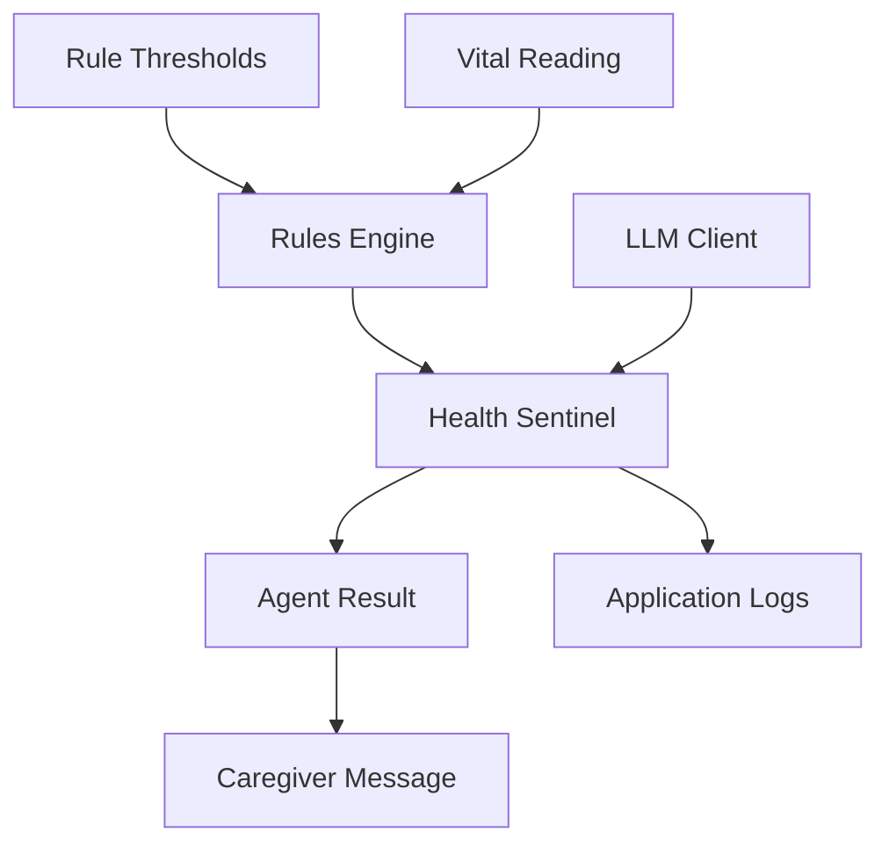

# PR #35: Experiment: change heart-rate handling (throwaway, do not merge)

- State: CLOSED
- Head at fetch: f5477d819f534ee6ad657f860af78143880e1b35
- https://github.com/sksangita/evergreen-agents/pull/35
- Qodo comments: 2


---
<!-- https://github.com/sksangita/evergreen-agents/pull/35#issuecomment-7055643635 created 2026-11-21T02:06:55Z -->

<h3>PR Summary by Qodo</h3>

Experiment: plant heart-rate safety regressions (do not merge)


<code>✨ Enhancement</code> <code>🧪 Tests</code> <code>⚙️ Configuration changes</code> <code>🕐 10-20 Minutes</code>


<details>
<summary>AI Description</summary>

<dl>
<dd>
<br/>

><pre>
>• Adds an agent-level escalation condition and logs health values, contrary to repository safety
>  rules.
>• Removes the date and timezone from heart-rate alerts and weakens the assertion that checked them.
>• Changes rule-source wording and adds a test that requires network access.
></pre>

</dd>
</dl>

</details>

<!-- qodo-describe-risk-slot --><!-- qodo-describe-risk -->
<!-- qodo-describe-risk-start:1795226903.834497929 -->

<details>
<summary>Merge Risk <code>🟡 Medium</code></summary>

<dl>
<dd>

<br/>

<details>
<summary>Blast radius <code>🟡 Medium</code> <code>💥 2 capabilities</code></summary>

<dl>
<dd>

<br/>

- 2 affected capabilities within one bounded functional scope: health&#95;sentinel&#95;reading&#95;assessment.
- The changed log is produced as part of the same reading-to-triage assessment path used by the CLI.
- It is not an independent deployment layer; it is a side effect of this bounded Health Sentinel integration.
- This is a distinct delivery surface and user outcome of the same bounded Health Sentinel integration: conveying the measured value, triage, and time to a caregiver.
- It shares the assessment scope with triage but is not a separate technical layer.
- The escalation flag is part of the same end-to-end reading assessment result.
- It is not a separate functional scope from triage; it is another output of the Health Sentinel integration.


</dd>
</dl>

</details>
<details>
<summary>Behavioral complexity <code>🟢 Low</code> <code>🧩 Straightforward</code></summary>

<dl>
<dd>

<br/>

- Before: assessment produced the deterministic triage and result without logging the measurement values.
- After: one unconditional logging statement records the elder ID and values mapping.
- New correctness condition: logging must not disclose sensitive health values; the change is a direct side effect with no new state machine, algorithm, or coordination protocol.


</dd>
</dl>

</details>
<details>
<summary>Potential damage <code>🔴 High</code> <code>🩹 Confidentiality</code></summary>

<dl>
<dd>

<br/>

- Vital readings are health information.
- Reverting the code stops future emissions but does not remove records already accepted by log sinks or copied into downstream logging systems.
- Repair requires log access-control review and deletion/retention handling, none of which is implemented here.
- The equal-importance baseline is used; this classification is based on the concrete exposure of health measurements, not on business criticality.
- Future exposure is reversible by code rollback and log configuration changes, but already emitted records may require manual deletion or retention-expiry action.
- External copies and operator access cannot be compensated automatically by this repository.


</dd>
</dl>

</details>
<sub>Assessed commit <a href="https://github.com/sksangita/evergreen-agents/commit/f5477d819f534ee6ad657f860af78143880e1b35">f5477d8</a></sub>


<!-- https://github.com/sksangita/evergreen-agents/commit/f5477d819f534ee6ad657f860af78143880e1b35 -->
</dd>
</dl>
</details>
<!-- /qodo-describe-risk -->

<details>
<summary>Diagram</summary>

<dl>
<dd>

<br/>



</dd>
</dl>

</details>


<details>
<summary>High-Level Assessment</summary>

<dl>
<dd>

<br/>

>The following are alternative approaches to this PR:

<details>
<summary><b>1. Keep escalation rules-driven</b></summary>

<dl>
<dd>

- ➕ Preserves one auditable source for triage and escalation.
- ➕ Allows threshold-edge and alert-format tests to remain strict and offline.
- ➖ Requires a reviewed rule change and corresponding regression cases if new behavior is genuinely needed.

</dd>
</dl>

</details>

>**Recommendation:** Close this throwaway control PR after review; do not merge it. If heart-rate escalation needs a real change, implement it in the rules layer with reviewed sources and edge tests, retain date-and-zone alert formatting, and keep health values out of logs.

</dd>
</dl>

</details>

<details>
<summary> Files changed (4) <code> +19 / -8 </code> </summary>

<dl>
<dd>

<br/>

<details>
<summary>Enhancement (1) <code> +11 / -2 </code></summary>

<dl>
<dd>

<details>
<summary>agent.py<code>Add unsafe reading logs and agent-level heart-rate behavior</code> <code>+11/-2</code></summary>

<br/>

>Add unsafe reading logs and agent-level heart-rate behavior
>
><pre>
>• Logs elder IDs and raw measurements. Adds a bpm &gt; 150 escalation condition in the agent, although existing rules already mark readings above 130 bpm red; heart-rate caregiver messages now show only a clock time, without date or timezone.
></pre>
>
><a href='https://github.com/sksangita/evergreen-agents/pull/35/files#diff-cb3f24e657bc617c84440ac5d4d5542fd38b69f7aec8db4780b74a36ea70104b'>agents/health_sentinel/agent.py</a>

</details>

</dd>
</dl>

</details>

<details>
<summary>Tests (2) <code> +7 / -5 </code></summary>

<dl>
<dd>

<details>
<summary>test_heart_rate.py<code>Loosen the caregiver-message assertion</code> <code>+1/-5</code></summary>

<br/>

>Loosen the caregiver-message assertion
>
><pre>
>• Replaces the exact expected heart-rate caregiver message with a check that it is present for non-green results. The test no longer detects missing measurement text, date, timezone, or triage label.
></pre>
>
><a href='https://github.com/sksangita/evergreen-agents/pull/35/files#diff-91e715c9b7a0bf4241bc17e94976ab1d9c94ce9c4b8aab316bc50d5001933c08'>tests/test_heart_rate.py</a>

</details>

<details>
<summary>test_network_probe.py<code>Add a network-dependent connectivity test</code> <code>+6/-0</code></summary>

<br/>

>Add a network-dependent connectivity test
>
><pre>
>• Adds an unconditional test that opens a connection to example.com on port 443. This makes the offline test suite depend on external network availability.
></pre>
>
><a href='https://github.com/sksangita/evergreen-agents/pull/35/files#diff-3677480e22cbe66549b0d2bac276b77d109b23d574b79cb8075b3dfcac73e3a3'>tests/test_network_probe.py</a>

</details>

</dd>
</dl>

</details>

<details>
<summary>Other (1) <code> +1 / -1 </code></summary>

<dl>
<dd>

<details>
<summary>thresholds.yaml<code>Revise heart-rate rule source attribution</code> <code>+1/-1</code></summary>

<br/>

>Revise heart-rate rule source attribution
>
><pre>
>• Changes the amber heart-rate rule&#x27;s source text to a resting-heart-rate reference and removes its explicit unverified qualifier. The condition and triage level remain unchanged.
></pre>
>
><a href='https://github.com/sksangita/evergreen-agents/pull/35/files#diff-fe075708c66321086515e636cb9e48bc83368595fbb9808e08005b74277d77da'>core/rules/thresholds.yaml</a>

</details>

</dd>
</dl>

</details>

</dd>
</dl>

</details>

<!-- qodo-describe-head:f5477d819f534ee6ad657f860af78143880e1b35 -->

---
<!-- https://github.com/sksangita/evergreen-agents/pull/35#issuecomment-7055664998 created 2026-11-21T02:08:20Z -->

<h3>Code Review by Qodo</h3>

<br/>


<details>
<summary>  1.  Health readings written to logs <code>📘 Rule violation</code></summary>

<br/>

> <details>
><summary>Description</summary>
><br/>
>
><pre>
><b><i>HealthSentinel.assess</i></b> passes <b><i>reading.values</i></b> and <b><i>reading.elder_id</i></b> to <b><i>logger.info</i></b>, recording
>identifiable heart-rate or blood-pressure measurements rather than just a correlation identifier.
>Every successful assessment emits this record when INFO logging is enabled, making the data
>available in configured log sinks and causing the existing log-safety test to fail for a
>blood-pressure reading.
></pre>
></details>

> <details>
><summary>Agent prompt</summary>
><br/>
>
>```
>The issue below was found during a code review. Follow the provided context and guidance below and implement a solution
>
>## Issue description
>Assessment logging in `HealthSentinel.assess` exposes health measurements and an associated elder identifier. The existing log-safety test fails when it captures a blood-pressure assessment.
>
>## Fix Focus Areas
>- agents/health_sentinel/agent.py[22-25]
>- tests/test_health_sentinel.py[100-107]
>
>## Recommended Fix
>Remove `reading.values` and `reading.elder_id` from the log call. If an assessment event is needed, log `trace_id` and the triage level only, for example: `logger.info('assessed reading trace_id=%s triage=%s', trace_id, decision.triage.value)`. Retain the existing log-safety test.
>```
> <code>ⓘ Copy this prompt and use it to remediate the issue with your preferred AI generation tools</code>
></details>

[Dismiss ↗](https://app.qodo.ai/findings/3c0fbfee-5749-4af2-993a-ed038d086d84?action=dismiss&origin=git) | [View ↗](https://app.qodo.ai/findings/3c0fbfee-5749-4af2-993a-ed038d086d84)

</details>


<details>
<summary>  2.  Escalation decided outside rules engine <code>📘 Rule violation</code></summary>

<br/>

> <details>
><summary>Description</summary>
><br/>
>
><pre>
><b><i>HealthSentinel.assess</i></b> sets <b><i>requires_escalation</i></b> using an inline <b><i>bpm &gt; 150</i></b> cutoff instead of
>relying solely on <b><i>decision.requires_escalation</i></b>, and that cutoff is absent from <b><i>thresholds.yaml</i></b>
>and any rule version. With a supplied rule set that does not classify a valid reading above 150 bpm
>as red, the result can report green or amber triage while the CLI says to escalate; the shipped
>rules mask this because they classify values above 130 as red.
></pre>
></details>

> <details>
><summary>Agent prompt</summary>
><br/>
>
>```
>The issue below was found during a code review. Follow the provided context and guidance below and implement a solution
>
>## Issue description
>`HealthSentinel.assess` computes `requires_escalation` with an inline `bpm > 150` check in addition to the rules result, allowing escalation to disagree with configured triage rules.
>
>## Fix Focus Areas
>- agents/health_sentinel/agent.py[34-43]
>- core/rules/thresholds.yaml[20-30]
>
>## Recommended Fix
>Remove the agent-side `bpm > 150` clause and set `requires_escalation=decision.requires_escalation`. If a new heart-rate escalation cutoff is intended, define and test it in the rules layer and `thresholds.yaml` so the rules engine returns it in `decision`.
>```
> <code>ⓘ Copy this prompt and use it to remediate the issue with your preferred AI generation tools</code>
></details>

[Dismiss ↗](https://app.qodo.ai/findings/c7a027a3-d227-4824-a997-ba6975df507b?action=dismiss&origin=git) | [View ↗](https://app.qodo.ai/findings/c7a027a3-d227-4824-a997-ba6975df507b)

</details>


<details>
<summary>  3.  Caregiver time shows clock only <code>📘 Rule violation</code></summary>

<br/>

> <details>
><summary>Description</summary>
><br/>
>
><pre>
><b><i>_caregiver_message</i></b> formats heart-rate <b><i>reading.measured_at</i></b> as <b><i>%H:%M</i></b> instead of using
><b><i>_utc_text</i></b>, dropping the date and timezone. Every amber or red heart-rate message therefore shows
>only a recurring clock time, and readings measured outside UTC show the source zone’s time without
>identifying that zone.
></pre>
></details>

> <details>
><summary>Agent prompt</summary>
><br/>
>
>```
>The issue below was found during a code review. Follow the provided context and guidance below and implement a solution
>
>## Issue description
>Heart-rate caregiver messages format the event time as `%H:%M`, omitting the date and timezone; offset timestamps also remain in their source zone without identifying it.
>
>## Fix Focus Areas
>- agents/health_sentinel/agent.py[52-61]
>- tests/test_heart_rate.py[70-73]
>
>## Recommended Fix
>Remove the heart-rate-specific clock-only formatting and use `_utc_text(reading.measured_at)` for heart-rate and blood-pressure messages alike. Verify the complete caregiver text for readings measured in UTC and non-UTC zones.
>```
> <code>ⓘ Copy this prompt and use it to remediate the issue with your preferred AI generation tools</code>
></details>

[Dismiss ↗](https://app.qodo.ai/findings/80480718-ebb3-4a5a-8915-acd3f6165582?action=dismiss&origin=git) | [View ↗](https://app.qodo.ai/findings/80480718-ebb3-4a5a-8915-acd3f6165582)

</details>


<br/>

<details><summary><ins><strong>View medium (3)</strong></ins></summary><br/>


<details>
<summary>  4.  Caregiver text assertion dropped <code>📘 Rule violation</code></summary>

<br/>

> <details>
><summary>Description</summary>
><br/>
>
><pre>
><b><i>test_heart_rate_full_result</i></b> checks only whether <b><i>message_for_caregiver</i></b> is present instead of
>asserting the complete caregiver text. A message with the wrong bpm, timestamp or triage
>label—including one whose timestamp loses its date and zone—can therefore pass, and no other
>heart-rate test checks the complete text; the PR description gives no reason for weakening the
>assertion.
></pre>
></details>

> <details>
><summary>Agent prompt</summary>
><br/>
>
>```
>The issue below was found during a code review. Follow the provided context and guidance below and implement a solution
>
>## Issue description
>`test_heart_rate_full_result` no longer detects incorrect caregiver-message content because its exact-text assertion was replaced with a presence check without a documented reason.
>
>## Fix Focus Areas
>- tests/test_heart_rate.py[69-77]
>- agents/health_sentinel/agent.py[55-60]
>
>## Recommended Fix
>Correct the caregiver-message formatting so the timestamp includes its date and timezone, then restore an assertion comparing `result.message_for_caregiver` with the complete expected message, including bpm, timestamp and triage label. Keep the green case’s `None` expectation. If a timestamp-format change is intentional, update the expected string to match and explain the change in the PR description.
>```
> <code>ⓘ Copy this prompt and use it to remediate the issue with your preferred AI generation tools</code>
></details>

[Dismiss ↗](https://app.qodo.ai/findings/4ade87fd-1f01-4434-a137-c1ede767731b?action=dismiss&origin=git) | [View ↗](https://app.qodo.ai/findings/4ade87fd-1f01-4434-a137-c1ede767731b)

</details>


<details>
<summary>  5.  Test needs live network host <code>📘 Rule violation</code></summary>

<br/>

> <details>
><summary>Description</summary>
><br/>
>
><pre>
><b><i>test_can_reach_example_host</i></b> unconditionally opens a TCP connection to <b><i>example.com:443</i></b> instead of
>running offline. When the host is unreachable from an offline or network-restricted runner, the test
>fails and blocks <b><i>make test</i></b> in pull-request CI for a reason unrelated to application behavior.
></pre>
></details>

> <details>
><summary>Agent prompt</summary>
><br/>
>
>```
>The issue below was found during a code review. Follow the provided context and guidance below and implement a solution
>
>## Issue description
>`tests/test_network_probe.py` makes the routine test suite depend on access to `example.com:443`, causing offline runs to fail.
>
>## Fix Focus Areas
>- tests/test_network_probe.py[1-6]
>- Makefile[6-8]
>
>## Recommended Fix
>Remove the external connectivity probe from the routine suite, or replace the socket call with a fake transport so the test runs fully offline. If the probe serves a separate diagnostic purpose, make it explicitly opt-in so `make test` and pull-request CI do not run it.
>```
> <code>ⓘ Copy this prompt and use it to remediate the issue with your preferred AI generation tools</code>
></details>

[Dismiss ↗](https://app.qodo.ai/findings/94d561bf-2356-4e5a-b0d1-2e6ba524ba45?action=dismiss&origin=git) | [View ↗](https://app.qodo.ai/findings/94d561bf-2356-4e5a-b0d1-2e6ba524ba45)

</details>


<details>
<summary>  6.  An unverified threshold loses its caveat <code>🐞 Bug</code></summary>

<br/>

> <details>
><summary>Description</summary>
><br/>
>
><pre>
>The <b><i>hr.high</i></b> source text drops its explicit <b><i>unverified</i></b> qualification even though the threshold&#x27;s
>reference has not been verified. Anyone reviewing that rule&#x27;s provenance now sees a more
>authoritative-sounding resting-heart-rate reference, while the repository still identifies threshold
>sources as unverified demo material.
></pre>
></details>

> <details>
><summary>Agent prompt</summary>
><br/>
>
>```
>The issue below was found during a code review. Follow the provided context and guidance below and implement a solution
>
>## Issue description
>The heart-rate amber rule's source no longer discloses that its cited reference is unverified.
>## Fix Focus Areas
>- core/rules/thresholds.yaml[27-31]
>## Recommended Fix
>Retain the `unverified` qualifier in this source until its reference has been checked through human review; do not imply verification through a wording-only change.
>```
> <code>ⓘ Copy this prompt and use it to remediate the issue with your preferred AI generation tools</code>
></details>

[Dismiss ↗](https://app.qodo.ai/findings/37ebb42c-4a04-49a9-b504-2d905c494113?action=dismiss&origin=git) | [View ↗](https://app.qodo.ai/findings/37ebb42c-4a04-49a9-b504-2d905c494113)

</details>


</details>

<br/>

<!-- qodo-self-review-slot -->


<!-- qodo-context:start -->
<details><summary><strong>Context sources</strong></summary>

<div>&#x2705; Linked PRs:</div>
<div>&nbsp;&nbsp;<code>🌐 PR #34</code></div>
<div>&nbsp;&nbsp;<code>🌐 PR #33</code></div>
<div>&#x2705; Compliance rules (platform): <a href="https://app.qodo.ai/rules?state=active&amp;scopes=/sksangita/evergreen-agents/"><code>25 rules</code></a></div>
<div>Review mode: <code>⚖️ Balanced</code>: Comment request</div>
<!-- qodo-context:end -->
</details>

<br/>
<!-- https://github.com/sksangita/evergreen-agents/commit/f5477d819f534ee6ad657f860af78143880e1b35 -->

