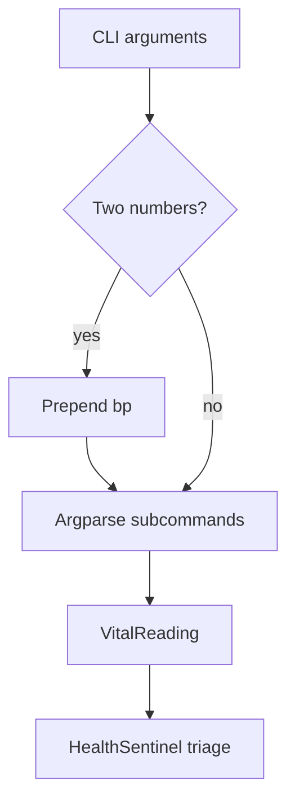

# PR #36: Experiment: accept the old CLI form for backward compatibility (Day 12, do not merge)

- State: CLOSED
- Head at fetch: 8795217595688bb205a9fc65afd1f1cc6bac0d29
- https://github.com/sksangita/evergreen-agents/pull/36
- Qodo comments: 2


---
<!-- https://github.com/sksangita/evergreen-agents/pull/36#issuecomment-7055939844 created 2026-11-21T02:29:18Z -->

<h3>PR Summary by Qodo</h3>

Accept legacy positional blood pressure arguments in the demo CLI


<code>✨ Enhancement</code> <code>🕐 Less than 10 minutes</code>


<details>
<summary>AI Description</summary>

<dl>
<dd>
<br/>

><pre>
>• Accept two bare numeric arguments as a blood pressure reading for legacy scripts.
>• Keep the existing <b><i>bp</i></b> and <b><i>hr</i></b> subcommands and reading validation unchanged.
>• This do-not-merge experiment conflicts with an unchanged test requiring a subcommand.
></pre>

</dd>
</dl>

</details>

<!-- qodo-describe-risk-slot --><!-- qodo-describe-risk -->
<!-- qodo-describe-risk-start:1795229126.225220919 -->

<details>
<summary>Merge Risk <code>🟡 Medium</code></summary>

<dl>
<dd>

<br/>

<details>
<summary>Blast radius <code>🟢 Low</code> <code>💥 1 capability</code></summary>

<dl>
<dd>

<br/>

- 1 affected end-to-end capability after fault-specific containment; implementation boundaries do not widen its functional scope.
- The changed parser feeds the existing VitalReading, HealthSentinel, rules and terminal-output flow for one end-to-end health-sentinel reading triage behavior.
- These are implementation hops of the same bounded integration, not independent capabilities.
- No separate downstream functional consumer was found.


</dd>
</dl>

</details>
<details>
<summary>Behavioral complexity <code>🟡 Medium</code> <code>🧩 Compatibility cases</code></summary>

<dl>
<dd>

<br/>

- Before: argparse required an explicit subcommand, so two numeric tokens were rejected as an invalid invocation.
- After: a pre-parser compatibility branch recognizes exactly two float-convertible tokens and rewrites them as a BP command, while explicit bp/hr commands continue through the existing parser.
- New correctness condition: the compatibility discriminator must distinguish the supported legacy BP form from other two-token invocations without bypassing validation or changing explicit subcommand behavior.
- The change uses existing parsing and validation infrastructure; the new interaction is the compatibility precedence between raw-argument shape and subcommand parsing, not the routine use of float conversion.


</dd>
</dl>

</details>
<details>
<summary>Potential damage <code>🟡 Medium</code> <code>🩹 Incorrect results</code></summary>

<dl>
<dd>

<br/>

- If the two numeric tokens were intended as an invalid or differently structured invocation, the new rewrite can yield a BP triage and escalation decision instead of a usage error.
- Within this capability, the error is recoverable by correcting and rerunning the command; no persistent state or external side effect is created by the CLI path itself.
- If the invocation is the explicitly supported legacy BP form, the behavior is correct rather than faulty.
- Code rollback removes the compatibility behavior.
- An activated bad invocation requires no state repair: rerun with the intended subcommand or corrected arguments.
- Any user who acted on an incorrect printed escalation would require manual correction; the source does not show automatic compensation.


</dd>
</dl>

</details>
<sub>Assessed commit <a href="https://github.com/sksangita/evergreen-agents/commit/8795217595688bb205a9fc65afd1f1cc6bac0d29">8795217</a></sub>


<!-- https://github.com/sksangita/evergreen-agents/commit/8795217595688bb205a9fc65afd1f1cc6bac0d29 -->
</dd>
</dl>
</details>
<!-- /qodo-describe-risk -->

<details>
<summary>Diagram</summary>

<dl>
<dd>

<br/>



</dd>
</dl>

</details>


<details>
<summary>High-Level Assessment</summary>

<dl>
<dd>

<br/>

>Normalizing legacy arguments before argparse reuses the existing parsing and validation path, rather than introducing a separate parser. It is a reasonable approach if backward compatibility is intended, but the conflicting subcommand-required test must be resolved before any merge.

</dd>
</dl>

</details>

<details>
<summary> Files changed (1) <code> +13 / -1 </code> </summary>

<dl>
<dd>

<br/>

<details>
<summary>Enhancement (1) <code> +13 / -1 </code></summary>

<dl>
<dd>

<details>
<summary>__main__.py<code>Route two bare numbers through the blood pressure subcommand</code> <code>+13/-1</code></summary>

<br/>

>Route two bare numbers through the blood pressure subcommand
>
><pre>
>• Adds a numeric-argument check before parsing and prepends &#x27;bp&#x27; when exactly two bare numbers are supplied. Other arguments continue through the existing parser; the unchanged subcommand-required test now fails for the legacy form.
></pre>
>
><a href='https://github.com/sksangita/evergreen-agents/pull/36/files#diff-6ff1d34edde7c083e49d41974ed3c87662379a19ef09326d9ab2ac9919bcddbe'>agents/health_sentinel/__main__.py</a>

</details>

</dd>
</dl>

</details>

</dd>
</dl>

</details>

<!-- qodo-describe-head:736c415e62d5fb301c5fa0b645c1e0d53c343221 -->

---
<!-- https://github.com/sksangita/evergreen-agents/pull/36#issuecomment-7055945000 created 2026-11-21T02:29:42Z -->

<h3>Code Review by Qodo</h3>

<br/>


<details>
<summary>  1.  CLI silently accepts the retired two-number command form <code>📎 Requirement gap</code></summary>

<br/>

> <details>
><summary>Description</summary>
><br/>
>
><pre>
><b><i>main</i></b> rewrites two bare numeric arguments into a <b><i>bp</i></b> subcommand instead of letting argparse
>require an explicit subcommand. For <b><i>186 104</i></b>, the CLI triages a BP reading rather than printing
>usage and exiting with code 2, and the unchanged <b><i>test_cli_requires_subcommand[args1]</i></b> fails under
><b><i>make test</i></b>.
></pre>
></details>

> <details>
><summary>Agent prompt</summary>
><br/>
>
>```
>The issue below was found during a code review. Follow the provided context and guidance below and implement a solution
>
>## Issue description
>The CLI rewrites two bare numeric arguments into a `bp` subcommand, accepting a form that must instead print usage and exit non-zero. The existing `test_cli_requires_subcommand[args1]` checks this behavior, and the PR description reports that `make test` fails on it.
>
>## Fix Focus Areas
>- agents/health_sentinel/__main__.py[16-21]
>- agents/health_sentinel/__main__.py[38-42]
>- tests/test_cli.py[58-63]
>
>## Recommended Fix
>Remove the two-number rewrite and its now-unused `_is_number` helper, then pass `argv` directly to `parser.parse_args(argv)` so argparse requires `bp` or `hr`. Confirm that `186 104` prints usage and exits with code 2, that the existing test passes without edits, and that `make lint` and `make test` pass. Change the test or docs to accept the old form only if the ticket is changed to require it.
>```
> <code>ⓘ Copy this prompt and use it to remediate the issue with your preferred AI generation tools</code>
></details>

[Dismiss ↗](https://app.qodo.ai/findings/843245b0-b471-402a-86a3-b82d69cdbfa8?action=dismiss&origin=git) | [View ↗](https://app.qodo.ai/findings/843245b0-b471-402a-86a3-b82d69cdbfa8)

</details>


<br/>

<details><summary><ins><strong>View medium (1)</strong></ins></summary><br/>


<details>
<summary>  2.  Old-form CLI regression test removed, hiding a failing check <code>📘 Rule violation</code> <code>⭐ New</code></summary>

<br/>

> <details>
><summary>Description</summary>
><br/>
>
><pre>
><b><i>test_cli_requires_subcommand</i></b> drops <b><i>[&quot;186&quot;, &quot;104&quot;]</i></b> from its parametrization, removing the only
>assertion that bare two-number arguments exit nonzero with usage. When those arguments are passed,
><b><i>main</i></b> still prepends <b><i>bp</i></b> and triages the reading instead of rejecting it, while the PR description
>incorrectly claims no test was edited and the commit message acknowledges the uncovered gap.
></pre>
></details>

> <details>
><summary>Agent prompt</summary>
><br/>
>
>```
>The issue below was found during a code review. Follow the provided context and guidance below and implement a solution
>
>## Issue description
>The PR removes the only test case asserting that two bare numbers exit nonzero with usage. The CLI still accepts that form, and the PR description incorrectly says no test was edited.
>
>## Fix Focus Areas
>- tests/test_cli.py[56-63]
>
>## Recommended Fix
>Restore the parametrization to `[[], ["186", "104"]]` and retain the exit-code and usage assertions. Correct the CLI behavior so the restored test passes. If accepting the old form is intended, resolve that conflict with the ticket explicitly rather than silently deleting the test; in either case, update the PR description to identify and explain the changed assertion.
>```
> <code>ⓘ Copy this prompt and use it to remediate the issue with your preferred AI generation tools</code>
></details>

[Dismiss ↗](https://app.qodo.ai/findings/7ed473fa-314a-4b90-90b2-db535c6b01cd?action=dismiss&origin=git) | [View ↗](https://app.qodo.ai/findings/7ed473fa-314a-4b90-90b2-db535c6b01cd)

</details>


</details>

<br/>

<!-- qodo-self-review-slot -->


<!-- qodo-context:start -->
<details><summary><strong>Context sources</strong></summary>

<div>&#x2705; Tickets: <a href="https://github.com/sksangita/evergreen-agents/issues/22"><code>🎫 Triage resting heart rate as a second vital, with bp and hr CLI subcommands</code></a></div>
<div>&#x2705; Compliance rules (platform): <a href="https://app.qodo.ai/rules?state=active&amp;scopes=/sksangita/evergreen-agents/"><code>25 rules</code></a></div>
<div>Review mode: <code>⚖️ Balanced</code>: Comment request</div>
<!-- qodo-context:end -->
</details>

<br/>
<!-- https://github.com/sksangita/evergreen-agents/commit/8795217595688bb205a9fc65afd1f1cc6bac0d29 -->

