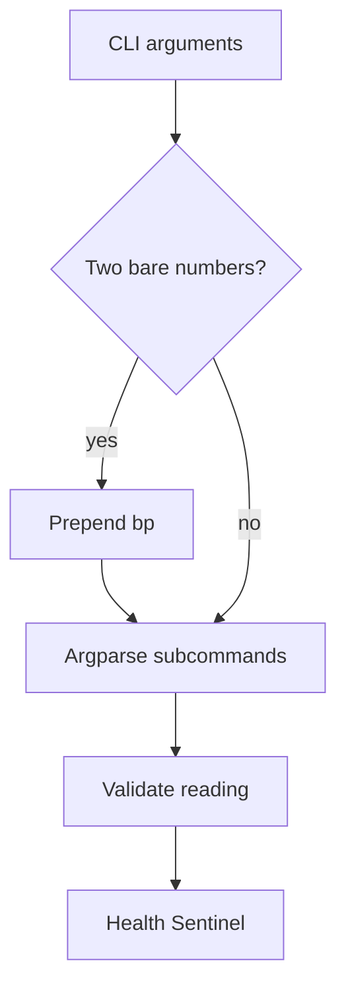

# PR #37: Experiment: accept the old CLI form for backward compatibility (Day 12 v2, do not merge)

- State: CLOSED
- Head at fetch: 215898d015ce9ba908880646339b33eba4ac0572
- https://github.com/sksangita/evergreen-agents/pull/37
- Qodo comments: 2


---
<!-- https://github.com/sksangita/evergreen-agents/pull/37#issuecomment-7056221191 created 2026-11-21T02:52:34Z -->

<h3>PR Summary by Qodo</h3>

Restore bare blood-pressure arguments in the demo CLI


<code>🐞 Bug fix</code> <code>🕐 Less than 10 minutes</code>


<details>
<summary>AI Description</summary>

<dl>
<dd>
<br/>

><pre>
>• Accept two bare numeric arguments as a blood-pressure reading for backward compatibility.
>• Remove the test that expected this legacy form to fail; no replacement coverage was added.
></pre>

</dd>
</dl>

</details>

<!-- qodo-describe-risk-slot --><!-- qodo-describe-risk -->
<!-- qodo-describe-risk-start:1795229588.964487076 -->

<details>
<summary>Merge Risk <code>🟢 Low</code></summary>

<dl>
<dd>

<br/>

<details>
<summary>Blast radius <code>🟢 Low</code> <code>💥 1 capability</code></summary>

<dl>
<dd>

<br/>

- 1 affected end-to-end capability after fault-specific containment; implementation boundaries do not widen its functional scope.
- The changed parser feeds the existing end-to-end CLI triage behavior, from command-line input through VitalReading construction and HealthSentinel assessment.
- The inspected repository contains no separate consumer or independent functional domain affected by this dispatch branch.

<details>
<summary>Sources</summary>

<dl>
<dd>

[agents/health_sentinel/__main__.py\[38-42\]](https://github.com/sksangita/evergreen-agents/blob/215898d015ce9ba908880646339b33eba4ac0572/agents/health_sentinel/__main__.py#L38-L42)

```python
    raw = sys.argv[1:] if argv is None else argv
    if len(raw) == 2 and all(_is_number(a) for a in raw):
        # Backward compatibility: `186 104` used to mean blood pressure.
        raw = ["bp", *raw]
    args = parser.parse_args(raw)
```

</dd>
</dl>

</details>

</dd>
</dl>

</details>
<details>
<summary>Behavioral complexity <code>🟢 Low</code> <code>🧩 Straightforward</code></summary>

<dl>
<dd>

<br/>

- Before: argparse required an explicit bp or hr subcommand.
- After: a small pre-parser condition recognizes exactly two float-convertible arguments and prepends bp.
- New correctness condition: the compatibility predicate must only recognize the intended legacy blood-pressure shape and must leave explicit subcommands and invalid readings on their existing paths.
- The branch does not introduce new state, ordering, persistence, concurrency, or a nontrivial transformation; existing VitalReading validation and triage logic are reused unchanged.

<details>
<summary>Sources</summary>

<dl>
<dd>

[agents/health_sentinel/__main__.py\[38-42\]](https://github.com/sksangita/evergreen-agents/blob/215898d015ce9ba908880646339b33eba4ac0572/agents/health_sentinel/__main__.py#L38-L42)

```python
    raw = sys.argv[1:] if argv is None else argv
    if len(raw) == 2 and all(_is_number(a) for a in raw):
        # Backward compatibility: `186 104` used to mean blood pressure.
        raw = ["bp", *raw]
    args = parser.parse_args(raw)
```

</dd>
</dl>

</details>

</dd>
</dl>

</details>
<details>
<summary>Potential damage <code>🟢 Low</code> <code>🩹 Reversible</code></summary>

<dl>
<dd>

<br/>

- For the hypothesized unsupported caller intent, the CLI may produce a triage result instead of the expected usage error.
- The user can recover by rerunning with an explicit subcommand.
- There is no evidence of persistent state, queued work, automatic downstream adoption, or external compensation requirements; restoring the code is sufficient and does not repair stored state.
- Fully recoverable by rerunning with explicit bp/hr syntax or reverting the compatibility branch.
- No persistent state or external effect remains to repair.

<details>
<summary>Sources</summary>

<dl>
<dd>

[agents/health_sentinel/__main__.py\[38-42\]](https://github.com/sksangita/evergreen-agents/blob/215898d015ce9ba908880646339b33eba4ac0572/agents/health_sentinel/__main__.py#L38-L42)

```python
    raw = sys.argv[1:] if argv is None else argv
    if len(raw) == 2 and all(_is_number(a) for a in raw):
        # Backward compatibility: `186 104` used to mean blood pressure.
        raw = ["bp", *raw]
    args = parser.parse_args(raw)
```

</dd>
</dl>

</details>

</dd>
</dl>

</details>
<sub>Assessed commit <a href="https://github.com/sksangita/evergreen-agents/commit/215898d015ce9ba908880646339b33eba4ac0572">215898d</a></sub>


<!-- https://github.com/sksangita/evergreen-agents/commit/215898d015ce9ba908880646339b33eba4ac0572 -->
</dd>
</dl>
</details>
<!-- /qodo-describe-risk -->

<details>
<summary>Diagram</summary>

<dl>
<dd>

<br/>



</dd>
</dl>

</details>


<details>
<summary>High-Level Assessment</summary>

<dl>
<dd>

<br/>

>Reusing the existing bp parser and validation path is simpler than adding a separate legacy parser. Add a positive test for bare numeric arguments before relying on the compatibility behavior; the changed test only removes the old rejection expectation.

</dd>
</dl>

</details>

<details>
<summary> Files changed (2) <code> +14 / -2 </code> </summary>

<dl>
<dd>

<br/>

<details>
<summary>Bug fix (1) <code> +13 / -1 </code></summary>

<dl>
<dd>

<details>
<summary>__main__.py<code>Route bare numeric pairs through the blood-pressure subcommand</code> <code>+13/-1</code></summary>

<br/>

>Route bare numeric pairs through the blood-pressure subcommand
>
><pre>
>• Detects exactly two numeric arguments and prepends &#x27;bp&#x27; before argparse processes them. Explicit subcommands continue through the existing parsing and validation path.
></pre>
>
><a href='https://github.com/sksangita/evergreen-agents/pull/37/files#diff-6ff1d34edde7c083e49d41974ed3c87662379a19ef09326d9ab2ac9919bcddbe'>agents/health_sentinel/__main__.py</a>

</details>

</dd>
</dl>

</details>

<details>
<summary>Tests (1) <code> +1 / -1 </code></summary>

<dl>
<dd>

<details>
<summary>test_cli.py<code>Stop expecting legacy blood-pressure arguments to fail</code> <code>+1/-1</code></summary>

<br/>

>Stop expecting legacy blood-pressure arguments to fail
>
><pre>
>• Removes the two-number case from the missing-subcommand test. It does not add a test asserting that the legacy form succeeds.
></pre>
>
><a href='https://github.com/sksangita/evergreen-agents/pull/37/files#diff-4e8715c7a425ee52e74b7df4d34efd32e8c92f3e60bd51bc2e1ad5943b82032e'>tests/test_cli.py</a>

</details>

</dd>
</dl>

</details>

</dd>
</dl>

</details>

<!-- qodo-describe-head:215898d015ce9ba908880646339b33eba4ac0572 -->

---
<!-- https://github.com/sksangita/evergreen-agents/pull/37#issuecomment-7056227043 created 2026-11-21T02:53:05Z -->

<h3>Code Review by Qodo</h3>

<br/>


<details>
<summary>  1.  Old positional CLI form still runs as blood pressure <code>📎 Requirement gap</code></summary>

<br/>

> <details>
><summary>Description</summary>
><br/>
>
><pre>
><b><i>main</i></b> rewrites two float-parseable bare arguments as a <b><i>bp</i></b> invocation, while
><b><i>test_cli_requires_subcommand</i></b> drops the case that checked rejection of <b><i>186 104</i></b>. As a result,
><b><i>python -m agents.health_sentinel 186 104</i></b> no longer prints usage and exits non-zero, and values
>such as <b><i>nan</i></b> or <b><i>inf</i></b> pass the shim and reach <b><i>VitalReading</i></b> construction.
></pre>
></details>

> <details>
><summary>Agent prompt</summary>
><br/>
>
>```
>The issue below was found during a code review. Follow the provided context and guidance below and implement a solution
>
>## Issue description
>The old positional CLI form `python -m agents.health_sentinel 186 104` must print usage and exit non-zero. The new two-number rewrite accepts it instead, and the test case checking its rejection was removed.
>
>## Fix Focus Areas
>- agents/health_sentinel/__main__.py[13-45]
>- tests/test_cli.py[58-58]
>
>## Recommended Fix
>Delete `_is_number` and the `raw = sys.argv[1:] if argv is None else argv` backward-compatibility rewrite, then pass `argv` directly to `parser.parse_args`. Restore the `test_cli_requires_subcommand` parametrization to `[[], ["186", "104"]]` so the bare two-number invocation remains checked for usage output and a non-zero exit. Keeping the old form would require a separate product decision, with the changed assertion and its reason recorded in the PR description.
>```
> <code>ⓘ Copy this prompt and use it to remediate the issue with your preferred AI generation tools</code>
></details>

[Dismiss ↗](https://app.qodo.ai/findings/e7d2d752-9c5b-44d5-b16d-fe99f361bb3d?action=dismiss&origin=git) | [View ↗](https://app.qodo.ai/findings/e7d2d752-9c5b-44d5-b16d-fe99f361bb3d)

</details>


<br/>

<!-- qodo-self-review-slot -->


<!-- qodo-context:start -->
<details><summary><strong>Context sources</strong></summary>

<div>&#x2705; Linked PRs:</div>
<div>&nbsp;&nbsp;<code>🌐 PR #36</code></div>
<div>&#x2705; Tickets: <a href="https://github.com/sksangita/evergreen-agents/issues/22"><code>🎫 Triage resting heart rate as a second vital, with bp and hr CLI subcommands</code></a></div>
<div>&#x2705; Compliance rules (platform): <a href="https://app.qodo.ai/rules?state=active&amp;scopes=/sksangita/evergreen-agents/"><code>25 rules</code></a></div>
<div>Review mode: <code>⚖️ Balanced</code>: Comment request</div>
<!-- qodo-context:end -->
</details>

<br/>
<!-- https://github.com/sksangita/evergreen-agents/commit/215898d015ce9ba908880646339b33eba4ac0572 -->

