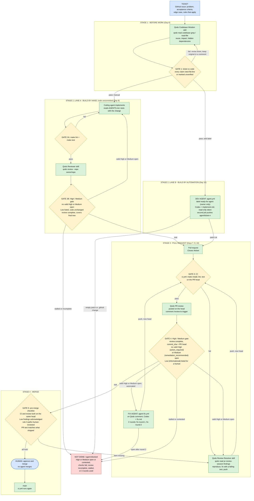

# The factory: from ticket to main

Everything built in Days 6 to 10, in one picture. Two ways to build (by hand with a coding agent, or by the
GitHub automation), one shared path to `main`. Rules and the definition of done are in `AGENTS.md`
("Quality gate for review loops"), which every agent reads.

Colours: green = a tool or agent does the work, yellow = a gate, blue = a human, red = stop.

## What each name is

| Name | What it is | Where |
|---|---|---|
| Qodo Codebase Wisdom skill | Questions about the code: reuse, impact, history. Cited answers. | Local, `qodo read codebase ...` |
| Qodo Reviewer skill | Reviews staged and unstaged changes before commit. Needs `--repo owner/repo` when `origin` is an SSH alias. | Local, `qodo review` |
| Qodo PR review | Posts "Code Review by Qodo" on the PR head. Starts on a `/review` comment. | Qodo bot on GitHub |
| Qodo Review Resolver skill | Reads the PR's findings as JSON (`action_level`, `commit_sha`), fixes valid ones, never records outcomes without an instruction. | Local, `qodo read pr-review-session findings` |
| DEV AGENT, `agent.yml` | `ready-for-agent` label starts Codex on one ticket. Read-only token makes a patch, a second job pushes `agent/ticket-<n>` and opens the PR. Refuses an empty patch or a `.github/` change. | GitHub Actions |
| FIX AGENT, `agent-fix.yml` | Qodo's comment starts Codex on the findings. Max 2 rounds, then `agent-blocked`. | GitHub Actions |
| `ci.yml` | `make install`, `make lint`, `make test` on every PR and on `main`. | GitHub Actions |
| `AGENTS.md` | The 7 rules, the High/Medium/Low gate, and the final report format. | Repo root |
| `.github/agent/implement.md`, `fix.md` | The prompts the two agents run. | Repo |

## The gates

| Gate | Must hold | Evidence | If it fails | Decides |
|---|---|---|---|---|
| 1. Ticket vs code | Every claim cited to code or marked unverified. No conflict with another ticket or rule. | Wisdom results with `file:line` | Revise the ticket, keep the original in a comment | You: go, revise or stop |
| 2A. Local checks | `make lint` and `make test` pass | Command output | Fix and rerun | The agent |
| 2B. Local High/Medium gate | No valid High or Medium open. Every Low listed with the code unchanged. Review complete and covering the final tree. | `qodo review` result; each finding reproduced; a test that fails without the fix | Fix, run 2A, review again. Contested finding: report evidence. Stalled or 3 rounds: stop. | You, for disagreements and Low |
| 3. CI | `test` check passes on the PR head | GitHub Actions run | Back to a fix | The agent |
| 4. PR High/Medium gate | Review complete, `commit_sha` equals the PR head, no valid High or Medium open. Low listed for a human. | `qodo read pr-review-session findings`, `gh pr view --json headRefOid` | Resolver or Fix agent fixes and pushes; wait for a review of the new head. Stalled or contested: stop. | You, for disagreements |
| 5. Pre-merge | Everything above holds on the current head. Rule 4 paths human-reviewed. PR text matches the diff. | Checklist | Back to the failing gate | You: approve and merge |

**High/Medium gate in one line:** fix every valid High and Medium (with a test that fails without the fix),
only report Low, never close a contested finding yourself, and the final review must be complete and cover the
final code. Severity map: High = `action_required`, Medium = `remediation_recommended`, Low = `informational`.

`main` is deliberately unprotected, so Gate 5 is the human decision plus the checklist, not a GitHub setting.

## What the Day 10 run showed (ticket #22, heart rate, PR #23)

Result: **reached `main`** (merge commit `f9e031a`), every gate held on the final head `d97a1aa`.

| Step | What happened | Worked? |
|---|---|---|
| Gate 1 | Wisdom found 5 issues; the ticket was revised before labelling | Yes |
| Dev agent (`agent.yml`) | The label started it; Codex opened PR #23 | Yes, but it added an unrequested change (a new error type, 8 test assertions rewritten). It was reverted. |
| Local review (Lane A) | Not run. Lane B has no local review step. | Gap |
| Gate 3 CI | Passed on the head | Yes, after a person approved the first run (GitHub holds CI on bot-opened PRs). The later push ran without approval. |
| Qodo PR review | Did not start on its own. `/review` was commented; the first try hit "trial ended". After that: 1 High and 2 Low. | Partly |
| Fix agent (`agent-fix.yml`) | Failed on both Qodo comments: `Actor 'qodo-code-review[bot]' ... Detected permission: 'none'`. No fix attempted. | **No** |
| Review Resolver skill | Run by a person with the agent: reproduced the High, fixed it with a failing-first test, pushed | Yes, manual |
| Gate 4 re-review | Complete on `d97a1aa`: High implemented, no Medium, one Low still open, one outdated | Yes |
| Gate 5 | CI and review on the same head, Low acknowledged, thresholds accepted by a person, PR text rewritten | Held; merged by a person |

### Where a person stepped in
Revised the ticket, added the label, posted `/review`, approved the first CI run, had the unrequested change
reverted, accepted the heart-rate thresholds (rule 4), acknowledged the Low finding and merged.

### Gaps and improvements
1. **Fix agent cannot start.** The Codex action rejects the Qodo bot as an actor. The workflow must allow that bot (a `.github/` change a person makes).
2. **`/review` is manual on bot-opened PRs.** Qodo reviewed the owner's PRs #19 and #21 within about 80 seconds, and needed `/review` on the automation's PRs #12 and #23. Probably Qodo skipping bot-authored PRs (inferred from the comment history, not documented).
3. **Review Resolver is not in the workflows.** `fix.md` reads Qodo's comment and ignores severity, so the High/Medium/Low gate is applied only by the local agent.
4. **Lane B skips Gate 1 and the local review.** Gate 1 ran only because a person did it before labelling.
5. **Dev agent scope:** Codex changed more than the ticket asked. A reviewer checks the diff against the acceptance criteria.
6. **CI needs approval** on PRs opened by automation.
7. **PR text goes stale:** the agent's report said NOT DONE after the fixes. Gate 5 includes "PR text matches what shipped" for this reason.
